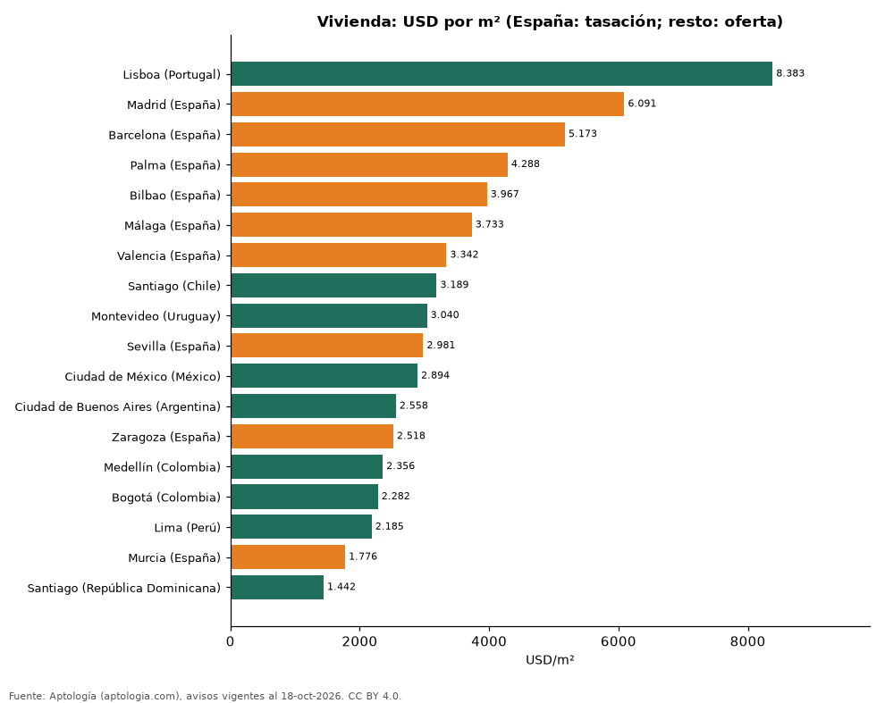

# España frente a Latinoamérica: cuánto cuesta el metro cuadrado en Madrid, Barcelona y las grandes ciudades latinoamericanas (octubre 2026)

**El metro cuadrado de vivienda en Madrid vale USD 6.091 según el valor tasado oficial del MIVAU (2026-T2), 2,7 veces el precio pedido en Bogotá (USD 2.282).** La ciudad latinoamericana más cara de la comparación, Santiago (Chile), pide USD 3.189 por m². En alquiler, Barcelona marca USD 18,7 por m² al mes (Incasòl, 2025) frente a USD 15,2 en Bogotá.

*Resumen: cruzamos el valor tasado oficial de 9 grandes municipios españoles con la oferta de Aptología en 9 ciudades.*

**Actualizado:** 18 de octubre de 2026 (datos del 18 de octubre de 2026) · **Próxima actualización:** mensual.

## Resumen

| Indicador | Valor |
|---|---|
| Madrid, compra (tasación) | USD 6.091/m² |
| Bogotá, compra (oferta) | USD 2.282/m² |
| Barcelona, alquiler | USD 18,7/m²/mes |
| Bogotá, alquiler | USD 15,2/m²/mes |

## Ciudades comparadas

| Ciudad | Compra USD/m² | Alquiler USD/m²/mes | Fuente |
|---|---|---|---|
| Lisboa (Portugal) | 8.383 | 25,8 | Aptología (oferta) |
| Madrid (España) | 6.091 | — | Oficial (MIVAU) |
| Barcelona (España) | 5.173 | 18,7 | Oficial (compra: MIVAU; alquiler: Incasòl) |
| Palma (España) | 4.288 | — | Oficial (MIVAU) |
| Bilbao (España) | 3.967 | — | Oficial (MIVAU) |
| Málaga (España) | 3.733 | — | Oficial (MIVAU) |
| Valencia (España) | 3.342 | — | Oficial (MIVAU) |
| Santiago (Chile) | 3.189 | 10,6 | Aptología (oferta) |
| Montevideo (Uruguay) | 3.040 | 15,3 | Aptología (oferta) |
| Sevilla (España) | 2.981 | — | Oficial (MIVAU) |
| Ciudad de México (México) | 2.894 | 18,1 | Aptología (oferta) |
| Ciudad de Buenos Aires (Argentina) | 2.558 | 13,5 | Aptología (oferta) |
| Zaragoza (España) | 2.518 | — | Oficial (MIVAU) |
| Medellín (Colombia) | 2.356 | 15,5 | Aptología (oferta) |
| Bogotá (Colombia) | 2.282 | 15,2 | Aptología (oferta) |
| Lima (Perú) | 2.185 | 10,0 | Aptología (oferta) |
| Murcia (España) | 1.776 | — | Oficial (MIVAU) |
| Santiago (República Dominicana) | 1.442 | 6,8 | Aptología (oferta) |

España: valor tasado por m² del MIVAU (2026-T2) y, para Barcelona, renta media por m² de los contratos registrados en el Incasòl (2025). Latinoamérica y Lisboa: precios pedidos de apartamentos en Aptología, octubre de 2026. Las fuentes no son idénticas: la española mide tasaciones y contratos; la latinoamericana, ofertas, que suelen ser más altas.

## Preguntas frecuentes

**¿Cuánto más cara es la vivienda en Madrid que en Bogotá?**
Por metro cuadrado, unas 2,7 veces: USD 6.091 (tasación oficial) frente a USD 2.282 (oferta).

**¿Es más caro alquilar en Barcelona o en Bogotá?**
En Barcelona: USD 18,7 por m² al mes en contratos de 2025 frente a USD 15,2 pedidos en Bogotá.

## Metodología

- **Fuente:** exportes nocturnos de la base de datos de Aptología (aptologia.com) del 18 de octubre de 2026: avisos vigentes de vivienda en portales inmobiliarios de 13 países, recogidos por Aptología y vistos en línea entre el 11 y el 18 de octubre de 2026. Corte: 18 de octubre de 2026.
- **Depuración:** se eliminan duplicados exactos (misma ciudad, zona, tipo, precio, moneda, área, habitaciones y baños) y los precios fuera del percentil 1–99 de cada país, operación, moneda y tipo; el precio por m² usa solo avisos con área declarada entre 12 y 2.000 m² y también se recorta al P1–P99.
- **Qué se mide:** precios pedidos (publicados), no precios de cierre. En arriendo, el canon mensual sin administración, gastos comunes ni condominio.
- **Muestra mínima:** cada cifra publicada se apoya en al menos 30 avisos; las celdas con menos se omiten.
- **Monedas:** nunca se mezclan avisos de monedas distintas sin convertirlos. Conversión a dólares con la tasa de mercado de ExchangeRate-API (open.er-api.com, actualización del 18 Oct 2026): 1 USD = 3.182,80 COP, 1 USD = 18,47 M.N, 1 USD = 5,09 BRL, 1 USD = 3,44 PEN, 1 USD = 982,44 CLP, 1 USD = 1.514,57 ARS, 1 USD = 40,20 UYU, 1 USD = 5.705,37 PYG, 1 USD = 61,27 DOP, 1 USD = 0,89 EUR, 1 USD = 11,72 BOB; la UF chilena a 41.178,64 CLP (mindicador,cl. 18-oct-2026). Los avisos publicados en dólares se usan tal cual.
- **España:** datos oficiales (MIVAU e Incasòl), no avisos; se convierten de EUR a USD con la misma tasa citada. Las cifras españolas son tasaciones y contratos, que suelen quedar por debajo de los precios pedidos.
- **Limitaciones:** la cobertura depende de los portales que recorre Aptología en cada país y es mayor en las ciudades grandes y en los segmentos medio-alto y alto; el área es la que declara el aviso, sin verificar; los nombres de zona vienen de los portales.
- **Privacidad:** solo se publican agregados; no se publica ningún dato personal, enlace a avisos ni nombre de anunciante.
- **Datos abiertos:** [datos.csv](datos.csv), licencia CC BY 4.0.

## Cómo citar

Pinzón Pineda, D. M. (2026). *España frente a Latinoamérica: cuánto cuesta el metro cuadrado en Madrid, Barcelona y las grandes ciudades latinoamericanas (octubre 2026)*. Aptología (aptologia.com). https://github.com/elbroker/aptologia-datos/tree/main/estudios/vivienda-espana-vs-latinoamerica-alquiler-y-compra-2026. Datos: datos.csv, licencia CC BY 4.0.
