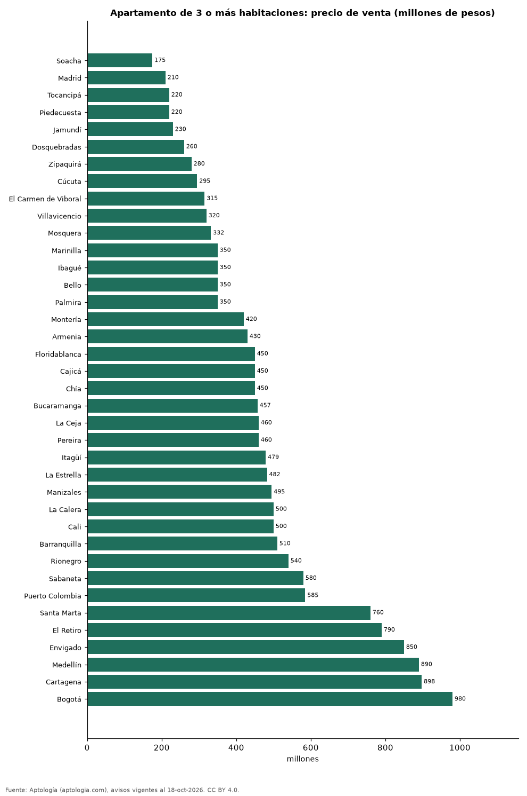

# Cuánto cuesta un apartamento de 3 o más habitaciones en las ciudades de Colombia: venta y arriendo (octubre 2026)

**Comprar un apartamento de 3 o más habitaciones cuesta en la mediana 175 millones de pesos en Soacha, la ciudad más barata de la muestra, y 980 millones de pesos en Bogotá, la más cara.** En Bogotá, el arriendo es de 6.500.000 pesos al mes.

*Resumen: comparamos 115.958 apartamentos de 3 o más habitaciones en 38 ciudades.*

**Actualizado:** 18 de octubre de 2026 (datos del 18 de octubre de 2026) · **Próxima actualización:** mensual.

## Resumen

| Indicador | Valor |
|---|---|
| Más barata (venta) | Soacha: 175 millones de pesos |
| Más cara (venta) | Bogotá: 980 millones de pesos |
| Bogotá (venta) | 980 millones de pesos |

## Ciudades

| Ciudad | Precio de venta | Arriendo mensual | Avisos (venta / arriendo) |
|---|---|---|---|
| Soacha | 175 millones de pesos | 950.000 pesos | 460 / 71 |
| Madrid | 210 millones de pesos | 1.200.000 pesos | 411 / 214 |
| Tocancipá | 220 millones de pesos | 1.090.500 pesos | 193 / 76 |
| Piedecuesta | 220 millones de pesos | 1.275.000 pesos | 196 / 46 |
| Jamundí | 230 millones de pesos | — | 189 / — |
| Dosquebradas | 260 millones de pesos | 1.600.000 pesos | 446 / 44 |
| Zipaquirá | 280 millones de pesos | 1.300.000 pesos | 710 / 161 |
| Cúcuta | 295 millones de pesos | 1.600.000 pesos | 559 / 283 |
| El Carmen de Viboral | 315 millones de pesos | 1.500.000 pesos | 61 / 51 |
| Villavicencio | 320 millones de pesos | 1.683.000 pesos | 260 / 32 |
| Mosquera | 332 millones de pesos | 1.600.000 pesos | 709 / 121 |
| Marinilla | 350 millones de pesos | 1.750.000 pesos | 96 / 49 |
| Ibagué | 350 millones de pesos | 1.400.000 pesos | 1.051 / 185 |
| Bello | 350 millones de pesos | 2.200.000 pesos | 1.668 / 768 |
| Palmira | 350 millones de pesos | — | 67 / — |
| Montería | 420 millones de pesos | 2.250.000 pesos | 258 / 38 |
| Armenia | 430 millones de pesos | 2.700.000 pesos | 1.451 / 173 |
| Floridablanca | 450 millones de pesos | 2.500.000 pesos | 836 / 305 |
| Cajicá | 450 millones de pesos | 2.800.000 pesos | 917 / 154 |
| Chía | 450 millones de pesos | 2.800.000 pesos | 676 / 147 |
| Bucaramanga | 457 millones de pesos | 2.600.000 pesos | 2.116 / 314 |
| La Ceja | 460 millones de pesos | 2.800.000 pesos | 150 / 183 |
| Pereira | 460 millones de pesos | 3.100.000 pesos | 3.061 / 939 |
| Itagüí | 479 millones de pesos | 2.850.000 pesos | 1.470 / 589 |
| La Estrella | 482 millones de pesos | 2.700.000 pesos | 316 / 232 |
| Manizales | 495 millones de pesos | 2.670.000 pesos | 1.944 / 147 |
| La Calera | 500 millones de pesos | — | 82 / — |
| Cali | 500 millones de pesos | 3.600.000 pesos | 6.694 / 800 |
| Barranquilla | 510 millones de pesos | 3.426.700 pesos | 5.796 / 2.036 |
| Rionegro | 540 millones de pesos | 2.700.000 pesos | 1.256 / 1.213 |
| Sabaneta | 580 millones de pesos | 3.300.000 pesos | 2.891 / 2.462 |
| Puerto Colombia | 585 millones de pesos | 3.400.000 pesos | 86 / 33 |
| Santa Marta | 760 millones de pesos | 4.175.000 pesos | 1.410 / 192 |
| El Retiro | 790 millones de pesos | 4.200.000 pesos | 135 / 92 |
| Envigado | 850 millones de pesos | 4.550.000 pesos | 4.146 / 4.545 |
| Medellín | 890 millones de pesos | 5.500.000 pesos | 15.088 / 11.945 |
| Cartagena | 898 millones de pesos | 4.800.000 pesos | 2.786 / 731 |
| Bogotá | 980 millones de pesos | 6.500.000 pesos | 20.632 / 5.229 |

Medianas del precio pedido; arriendo sin administración.

## Preguntas frecuentes

**¿Cuánto cuesta un apartamento de 3 o más habitaciones en Bogotá?**
980 millones de pesos en la mediana de la oferta en venta (octubre de 2026).

**¿Dónde es más barato comprar un apartamento de 3 o más habitaciones en Colombia?**
En Soacha: 175 millones de pesos.

## Metodología

- **Fuente:** exportes nocturnos de la base de datos de Aptología (aptologia.com) del 18 de octubre de 2026: avisos vigentes de vivienda en portales inmobiliarios de 13 países, recogidos por Aptología y vistos en línea entre el 11 y el 18 de octubre de 2026. Corte: 18 de octubre de 2026.
- **Depuración:** se eliminan duplicados exactos (misma ciudad, zona, tipo, precio, moneda, área, habitaciones y baños) y los precios fuera del percentil 1–99 de cada país, operación, moneda y tipo; el precio por m² usa solo avisos con área declarada entre 12 y 2.000 m² y también se recorta al P1–P99.
- **Qué se mide:** precios pedidos (publicados), no precios de cierre. En arriendo, el canon mensual sin administración, gastos comunes ni condominio.
- **Muestra mínima:** cada cifra publicada se apoya en al menos 30 avisos; las celdas con menos se omiten.
- **Colombia:** Precios en pesos colombianos, sin conversión de moneda.
- **Limitaciones:** la cobertura depende de los portales que recorre Aptología en cada país y es mayor en las ciudades grandes y en los segmentos medio-alto y alto; el área es la que declara el aviso, sin verificar; los nombres de zona vienen de los portales.
- **Privacidad:** solo se publican agregados; no se publica ningún dato personal, enlace a avisos ni nombre de anunciante.
- **Datos abiertos:** [datos.csv](datos.csv), licencia CC BY 4.0.

## Cómo citar

Pinzón Pineda, D. M. (2026). *Cuánto cuesta un apartamento de 3 o más habitaciones en las ciudades de Colombia: venta y arriendo (octubre 2026)*. Aptología (aptologia.com). https://github.com/elbroker/aptologia-datos/tree/main/estudios/vivienda-familiar-3-habitaciones-ciudades-colombia-2026. Datos: datos.csv, licencia CC BY 4.0.
