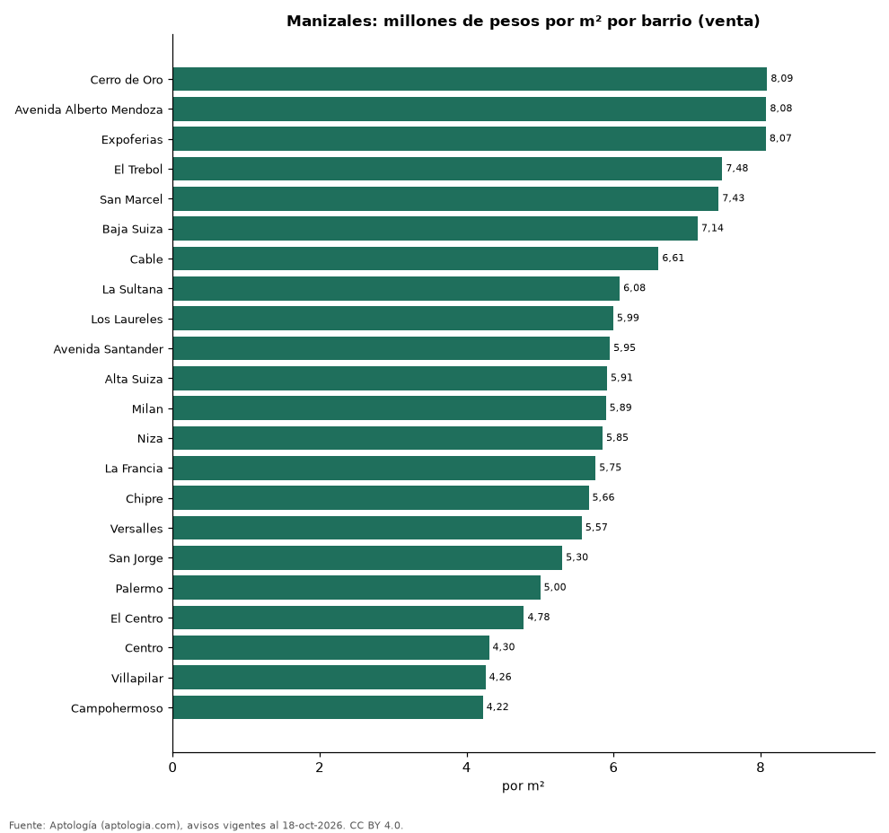
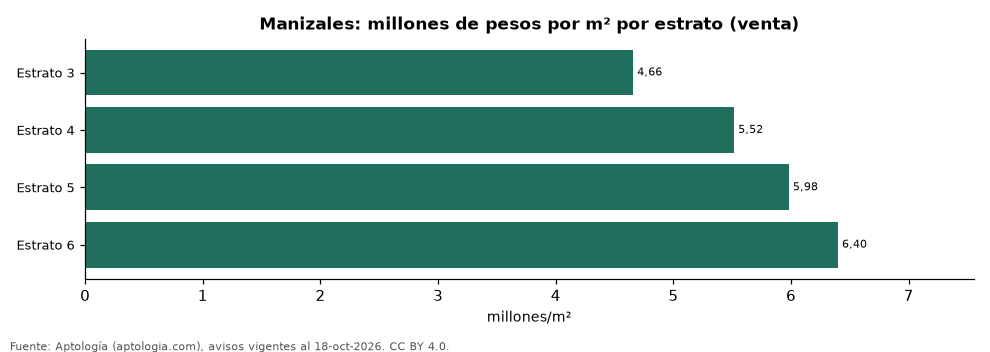

# Vivienda en Manizales: precio por m², arriendo, habitaciones, estrato y administración (octubre 2026)

**El barrio con el metro cuadrado más caro de Manizales es Cerro de Oro, con 8,09 millones de pesos en la mediana de apartamentos en venta; el más barato de la muestra es Campohermoso, con 4,22 millones de pesos.** Un apartamento de 2 habitaciones se arrienda por 1,65 millones de pesos al mes en la mediana y se vende por 350 millones de pesos. La rentabilidad bruta implícita del arriendo es 6,6 % anual. La administración equivale al 16,1 % del canon (264.000 pesos al mes en la mediana).

*Resumen: analizamos 3.113 avisos de apartamentos en Manizales (2.824 en venta y 289 en arriendo).*

**Actualizado:** 18 de octubre de 2026 (datos del 18 de octubre de 2026) · **Próxima actualización:** mensual.

## Resumen

| Indicador | Valor |
|---|---|
| Más caro (venta por m²) | Cerro de Oro: 8,09 millones de pesos |
| Más barato (venta por m²) | Campohermoso: 4,22 millones de pesos |
| Venta por m² (mediana) | 5,65 millones de pesos |
| Arriendo 2 habitaciones | 1,65 millones de pesos |
| Rentabilidad bruta implícita | 6,6 % |
| Administración / canon (mediana) | 16,1 % |
| Avisos | 3.113 |

## Barrios (30 avisos o más)

| Barrio | Venta por m² (millones de pesos) | Arriendo mensual (millones de pesos) | Avisos (venta / arriendo) |
|---|---|---|---|
| Cerro de Oro | 8,09 | — | 111 / — |
| Avenida Alberto Mendoza | 8,08 | — | 57 / — |
| Expoferias | 8,07 | — | 45 / — |
| El Trebol | 7,48 | — | 103 / — |
| San Marcel | 7,43 | — | 30 / — |
| Baja Suiza | 7,14 | — | 94 / — |
| Cable | 6,61 | — | 32 / — |
| La Sultana | 6,08 | — | 39 / — |
| Los Laureles | 5,99 | — | 56 / — |
| Avenida Santander | 5,95 | — | 96 / — |
| Alta Suiza | 5,91 | — | 66 / — |
| Milan | 5,89 | — | 150 / — |
| Niza | 5,85 | — | 49 / — |
| La Francia | 5,75 | — | 136 / — |
| Chipre | 5,66 | — | 112 / — |
| Versalles | 5,57 | — | 31 / — |
| San Jorge | 5,30 | — | 47 / — |
| Palermo | 5,00 | — | 310 / — |
| El Centro | 4,78 | — | 68 / — |
| Centro | 4,30 | — | 49 / — |
| Villapilar | 4,26 | — | 34 / — |
| Campohermoso | 4,22 | — | 39 / — |

Medianas de apartamentos; — indica menos de 30 avisos. El canon es mensual, sin administración ni gastos comunes.

## Precio por número de habitaciones

| Habitaciones | Precio de venta (mediana) | Arriendo mensual (mediana) | Avisos (venta / arriendo) |
|---|---|---|---|
| 1 | 348 millones de pesos | — | 104 / — |
| 2 | 350 millones de pesos | 1,65 millones de pesos | 767 / 126 |
| 3 o más | 495 millones de pesos | 2,67 millones de pesos | 1.944 / 147 |

## Por estrato

| Estrato | Venta por m² (millones) | Arriendo mensual (millones) | Avisos (venta / arriendo) |
|---|---|---|---|
| 3 | 4,66 | 1,45 | 473 / 43 |
| 4 | 5,52 | 1,80 | 691 / 87 |
| 5 | 5,98 | 1,72 | 407 / 50 |
| 6 | 6,40 | 3,30 | 1.185 / 103 |

Medianas; — indica menos de 30 avisos.

## Preguntas frecuentes

**¿Cuál es el barrio más caro de Manizales?**
Cerro de Oro, con 8,09 millones de pesos por m² en apartamentos en venta (octubre de 2026).

**¿Dónde es más barato comprar apartamento en Manizales?**
Entre los barrios con 30 avisos o más, en Campohermoso: 4,22 millones de pesos por m².

**¿Cuánto renta un apartamento en Manizales?**
La rentabilidad bruta implícita es 6,6 % anual (arriendo por m² × 12 ÷ precio de venta por m²), antes de gastos.

**¿Cuánto cuesta arrendar un apartamento de 2 habitaciones en Manizales?**
1,65 millones de pesos al mes en la mediana (octubre de 2026).

## Metodología

- **Fuente:** exportes nocturnos de la base de datos de Aptología (aptologia.com) del 18 de octubre de 2026: avisos vigentes de vivienda en portales inmobiliarios de 13 países, recogidos por Aptología y vistos en línea entre el 11 y el 18 de octubre de 2026. Corte: 18 de octubre de 2026.
- **Depuración:** se eliminan duplicados exactos (misma ciudad, zona, tipo, precio, moneda, área, habitaciones y baños) y los precios fuera del percentil 1–99 de cada país, operación, moneda y tipo; el precio por m² usa solo avisos con área declarada entre 12 y 2.000 m² y también se recorta al P1–P99.
- **Qué se mide:** precios pedidos (publicados), no precios de cierre. En arriendo, el canon mensual sin administración, gastos comunes ni condominio.
- **Muestra mínima:** cada cifra publicada se apoya en al menos 30 avisos; las celdas con menos se omiten.
- **Colombia:** Precios en pesos colombianos, sin conversión de moneda. Administración ÷ canon con razones entre 1 % y 80 %.
- **Limitaciones:** la cobertura depende de los portales que recorre Aptología en cada país y es mayor en las ciudades grandes y en los segmentos medio-alto y alto; el área es la que declara el aviso, sin verificar; los nombres de zona vienen de los portales.
- **Privacidad:** solo se publican agregados; no se publica ningún dato personal, enlace a avisos ni nombre de anunciante.
- **Datos abiertos:** [datos.csv](datos.csv), licencia CC BY 4.0.

## Cómo citar

Pinzón Pineda, D. M. (2026). *Vivienda en Manizales: precio por m², arriendo, habitaciones, estrato y administración (octubre 2026)*. Aptología (aptologia.com). https://github.com/elbroker/aptologia-datos/tree/main/estudios/vivienda-manizales-venta-arriendo-estrato-2026. Datos: datos.csv, licencia CC BY 4.0.
