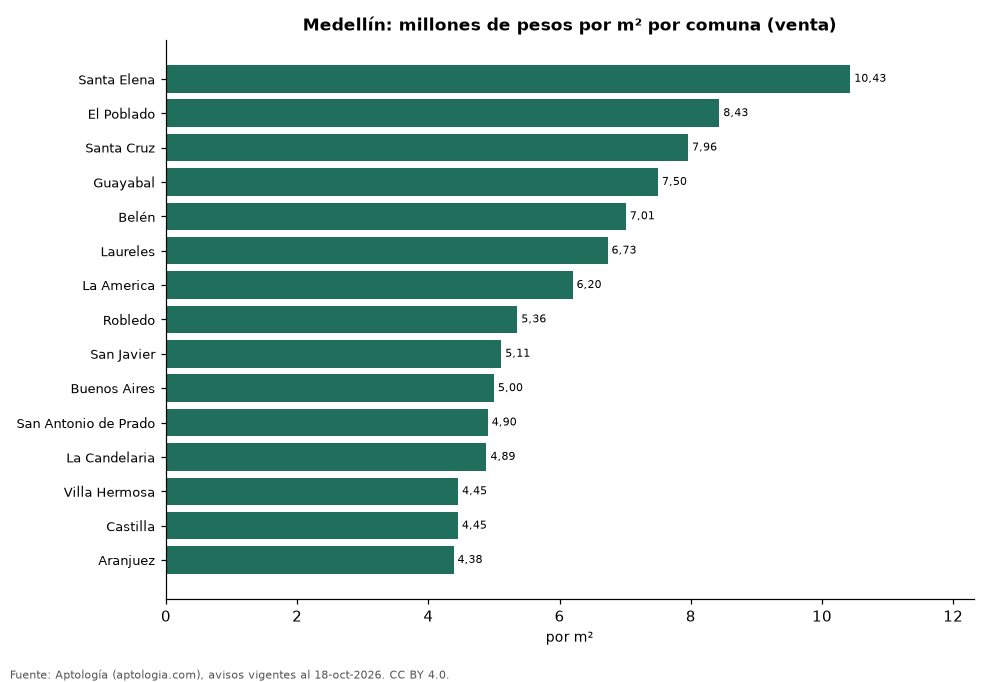
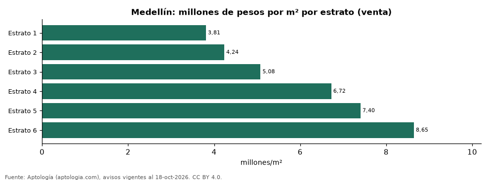

# Vivienda en Medellín: precio por m², arriendo, habitaciones, estrato y administración (octubre 2026)

**La comuna con el metro cuadrado más caro de Medellín es Santa Elena, con 10,43 millones de pesos en la mediana de apartamentos en venta; la más barata de la muestra es Aranjuez, con 4,38 millones de pesos.** Un apartamento de 2 habitaciones se arrienda por 4,20 millones de pesos al mes en la mediana y se vende por 720 millones de pesos. La rentabilidad bruta implícita del arriendo es 7,9 % anual. La administración equivale al 11,2 % del canon (700.000 pesos al mes en la mediana).

*Resumen: analizamos 41.420 avisos de apartamentos en Medellín (20.940 en venta y 20.480 en arriendo).*

**Actualizado:** 18 de octubre de 2026 (datos del 18 de octubre de 2026) · **Próxima actualización:** mensual.

## Resumen

| Indicador | Valor |
|---|---|
| Más cara (venta por m²) | Santa Elena: 10,43 millones de pesos |
| Más barata (venta por m²) | Aranjuez: 4,38 millones de pesos |
| Venta por m² (mediana) | 7,50 millones de pesos |
| Arriendo 2 habitaciones | 4,20 millones de pesos |
| Rentabilidad bruta implícita | 7,9 % |
| Administración / canon (mediana) | 11,2 % |
| Avisos | 41.420 |

## Comunas (30 avisos o más)

| Comuna | Venta por m² (millones de pesos) | Arriendo mensual (millones de pesos) | Avisos (venta / arriendo) |
|---|---|---|---|
| Santa Elena | 10,43 | 4,35 | 362 / 315 |
| El Poblado | 8,43 | 6,00 | 7.478 / 9.835 |
| Santa Cruz | 7,96 | 4,60 | 89 / 70 |
| Guayabal | 7,50 | 3,25 | 182 / 184 |
| Belén | 7,01 | 3,20 | 1.181 / 898 |
| Laureles | 6,73 | 3,90 | 3.006 / 2.337 |
| La America | 6,20 | 2,70 | 1.045 / 886 |
| Robledo | 5,36 | 2,20 | 512 / 464 |
| San Javier | 5,11 | 2,20 | 97 / 67 |
| Buenos Aires | 5,00 | 1,73 | 215 / 166 |
| San Antonio de Prado | 4,90 | 1,50 | 130 / 78 |
| La Candelaria | 4,89 | 2,60 | 688 / 493 |
| Villa Hermosa | 4,45 | 1,80 | 90 / 49 |
| Castilla | 4,45 | — | 44 / — |
| Aranjuez | 4,38 | 1,60 | 49 / 33 |

Medianas de apartamentos; — indica menos de 30 avisos. El canon es mensual, sin administración ni gastos comunes.

## Precio por número de habitaciones

| Habitaciones | Precio de venta (mediana) | Arriendo mensual (mediana) | Avisos (venta / arriendo) |
|---|---|---|---|
| 1 | 630 millones de pesos | 3,85 millones de pesos | 1.137 / 1.849 |
| 2 | 720 millones de pesos | 4,20 millones de pesos | 4.659 / 6.601 |
| 3 o más | 890 millones de pesos | 5,50 millones de pesos | 15.088 / 11.945 |

## Por estrato

| Estrato | Venta por m² (millones) | Arriendo mensual (millones) | Avisos (venta / arriendo) |
|---|---|---|---|
| 1 | 3,81 | — | 40 / — |
| 2 | 4,24 | 1,45 | 188 / 158 |
| 3 | 5,08 | 2,00 | 1.665 / 1.432 |
| 4 | 6,72 | 3,00 | 3.589 / 3.024 |
| 5 | 7,40 | 4,30 | 5.813 / 5.324 |
| 6 | 8,65 | 6,40 | 8.337 / 10.414 |

Medianas; — indica menos de 30 avisos.

## Preguntas frecuentes

**¿Cuál es la comuna más cara de Medellín?**
Santa Elena, con 10,43 millones de pesos por m² en apartamentos en venta (octubre de 2026).

**¿Dónde es más barato comprar apartamento en Medellín?**
Entre las comunas con 30 avisos o más, en Aranjuez: 4,38 millones de pesos por m².

**¿Cuánto renta un apartamento en Medellín?**
La rentabilidad bruta implícita es 7,9 % anual (arriendo por m² × 12 ÷ precio de venta por m²), antes de gastos.

**¿Cuánto cuesta arrendar un apartamento de 2 habitaciones en Medellín?**
4,20 millones de pesos al mes en la mediana (octubre de 2026).

## Metodología

- **Fuente:** exportes nocturnos de la base de datos de Aptología (aptologia.com) del 18 de octubre de 2026: avisos vigentes de vivienda en portales inmobiliarios de 13 países, recogidos por Aptología y vistos en línea entre el 11 y el 18 de octubre de 2026. Corte: 18 de octubre de 2026.
- **Depuración:** se eliminan duplicados exactos (misma ciudad, zona, tipo, precio, moneda, área, habitaciones y baños) y los precios fuera del percentil 1–99 de cada país, operación, moneda y tipo; el precio por m² usa solo avisos con área declarada entre 12 y 2.000 m² y también se recorta al P1–P99.
- **Qué se mide:** precios pedidos (publicados), no precios de cierre. En arriendo, el canon mensual sin administración, gastos comunes ni condominio.
- **Muestra mínima:** cada cifra publicada se apoya en al menos 30 avisos; las celdas con menos se omiten.
- **Colombia:** Precios en pesos colombianos, sin conversión de moneda. Administración ÷ canon con razones entre 1 % y 80 %.
- **Comunas:** cruce del barrio del aviso con la tabla barrio–comuna de Aptología (co_barrio_localidad). El corregimiento de Santa Elena incluye sectores como Las Palmas, El Tesoro y Mirador del Poblado, lo que explica su precio alto. Algunos nombres de barrio se repiten en varias comunas o se usan con poca precisión en los avisos, así que las comunas con pocos avisos (como Santa Cruz) deben leerse con cautela.
- **Limitaciones:** la cobertura depende de los portales que recorre Aptología en cada país y es mayor en las ciudades grandes y en los segmentos medio-alto y alto; el área es la que declara el aviso, sin verificar; los nombres de zona vienen de los portales.
- **Privacidad:** solo se publican agregados; no se publica ningún dato personal, enlace a avisos ni nombre de anunciante.
- **Datos abiertos:** [datos.csv](datos.csv), licencia CC BY 4.0.

## Cómo citar

Pinzón Pineda, D. M. (2026). *Vivienda en Medellín: precio por m², arriendo, habitaciones, estrato y administración (octubre 2026)*. Aptología (aptologia.com). https://github.com/elbroker/aptologia-datos/tree/main/estudios/vivienda-medellin-por-comuna-venta-arriendo-estrato-2026. Datos: datos.csv, licencia CC BY 4.0.
