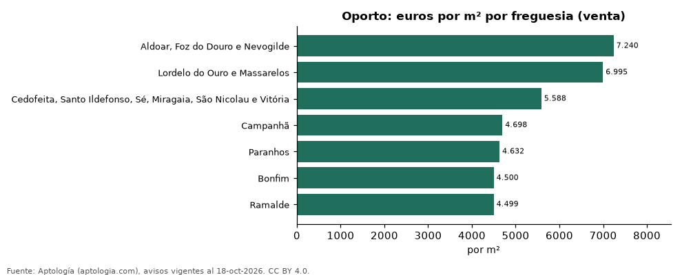

# Vivienda en Oporto: precio por m², arriendo, habitaciones y rentabilidad (octubre 2026)

**La freguesia con el metro cuadrado más caro de Oporto es Aldoar, Foz do Douro e Nevogilde, con 7.240 euros (USD 8.138) en la mediana de apartamentos en venta; la más barata de la muestra es Ramalde, con 4.499 euros (USD 5.057).** La rentabilidad bruta implícita del arriendo es 3,9 % anual.

*Resumen: analizamos 707 avisos de apartamentos en Oporto (625 en venta y 82 en arriendo).*

**Actualizado:** 18 de octubre de 2026 (datos del 18 de octubre de 2026) · **Próxima actualización:** mensual.

## Resumen

| Indicador | Valor |
|---|---|
| Más cara (venta por m²) | Aldoar, Foz do Douro e Nevogilde: 7.240 euros (USD 8.138) |
| Más barata (venta por m²) | Ramalde: 4.499 euros (USD 5.057) |
| Venta por m² (mediana) | 5.177 euros (USD 5.820) |
| Rentabilidad bruta implícita | 3,9 % |
| Avisos | 707 |

## Freguesias (30 avisos o más)

| Freguesia | Venta por m² (euros) | Arriendo mensual (euros) | Avisos (venta / arriendo) |
|---|---|---|---|
| Aldoar, Foz do Douro e Nevogilde | 7.240 | — | 49 / — |
| Lordelo do Ouro e Massarelos | 6.995 | — | 85 / — |
| Cedofeita, Santo Ildefonso, Sé, Miragaia, São Nicolau e Vitória | 5.588 | — | 161 / — |
| Campanhã | 4.698 | — | 67 / — |
| Paranhos | 4.632 | — | 94 / — |
| Bonfim | 4.500 | — | 69 / — |
| Ramalde | 4.499 | — | 82 / — |

Medianas de apartamentos; — indica menos de 30 avisos. El canon es mensual, sin administración ni gastos comunes.

## Precio por número de habitaciones

| Habitaciones | Precio de venta (mediana) | Arriendo mensual (mediana) | Avisos (venta / arriendo) |
|---|---|---|---|
| 1 | 295.000 euros (USD 331.604) | 1.070 euros (USD 1.203) | 177 / 30 |
| 2 | 430.875 euros (USD 484.339) | — | 254 / — |
| 3 o más | 749.850 euros (USD 842.894) | — | 194 / — |

## Preguntas frecuentes

**¿Cuál es la freguesia más cara de Oporto?**
Aldoar, Foz do Douro e Nevogilde, con 7.240 euros (USD 8.138) por m² en apartamentos en venta (octubre de 2026).

**¿Dónde es más barato comprar apartamento en Oporto?**
Entre las freguesias con 30 avisos o más, en Ramalde: 4.499 euros (USD 5.057) por m².

**¿Cuánto renta un apartamento en Oporto?**
La rentabilidad bruta implícita es 3,9 % anual (arriendo por m² × 12 ÷ precio de venta por m²), antes de gastos.

## Metodología

- **Fuente:** exportes nocturnos de la base de datos de Aptología (aptologia.com) del 18 de octubre de 2026: avisos vigentes de vivienda en portales inmobiliarios de 13 países, recogidos por Aptología y vistos en línea entre el 11 y el 18 de octubre de 2026. Corte: 18 de octubre de 2026.
- **Depuración:** se eliminan duplicados exactos (misma ciudad, zona, tipo, precio, moneda, área, habitaciones y baños) y los precios fuera del percentil 1–99 de cada país, operación, moneda y tipo; el precio por m² usa solo avisos con área declarada entre 12 y 2.000 m² y también se recorta al P1–P99.
- **Qué se mide:** precios pedidos (publicados), no precios de cierre. En arriendo, el canon mensual sin administración, gastos comunes ni condominio.
- **Muestra mínima:** cada cifra publicada se apoya en al menos 30 avisos; las celdas con menos se omiten.
- **Monedas:** nunca se mezclan avisos de monedas distintas sin convertirlos. Conversión a dólares con la tasa de mercado de ExchangeRate-API (open.er-api.com, actualización del 18 Oct 2026): 1 USD = 3.182,80 COP, 1 USD = 18,47 M.N, 1 USD = 5,09 BRL, 1 USD = 3,44 PEN, 1 USD = 982,44 CLP, 1 USD = 1.514,57 ARS, 1 USD = 40,20 UYU, 1 USD = 5.705,37 PYG, 1 USD = 61,27 DOP, 1 USD = 0,89 EUR, 1 USD = 11,72 BOB; la UF chilena a 41.178,64 CLP (mindicador,cl. 18-oct-2026). Los avisos publicados en dólares se usan tal cual.
- **Monedas:** venta en euros y arriendo en euros, la moneda mayoritaria de cada operación; los avisos en otra moneda se excluyen. Equivalencias en dólares con la tasa citada.
- **Área:** Oporto, Vila Nova de Gaia, Matosinhos; los municipios distintos de Oporto aparecen como una zona propia.
- **Limitaciones:** la cobertura depende de los portales que recorre Aptología en cada país y es mayor en las ciudades grandes y en los segmentos medio-alto y alto; el área es la que declara el aviso, sin verificar; los nombres de zona vienen de los portales.
- **Privacidad:** solo se publican agregados; no se publica ningún dato personal, enlace a avisos ni nombre de anunciante.
- **Datos abiertos:** [datos.csv](datos.csv), licencia CC BY 4.0.

## Cómo citar

Pinzón Pineda, D. M. (2026). *Vivienda en Oporto: precio por m², arriendo, habitaciones y rentabilidad (octubre 2026)*. Aptología (aptologia.com). https://github.com/elbroker/aptologia-datos/tree/main/estudios/vivienda-oporto-por-freguesia-2026. Datos: datos.csv, licencia CC BY 4.0.
