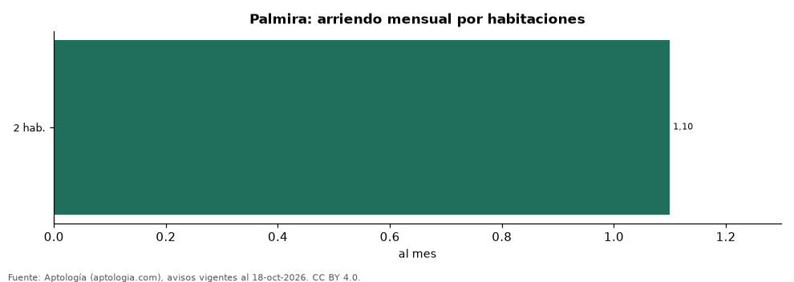
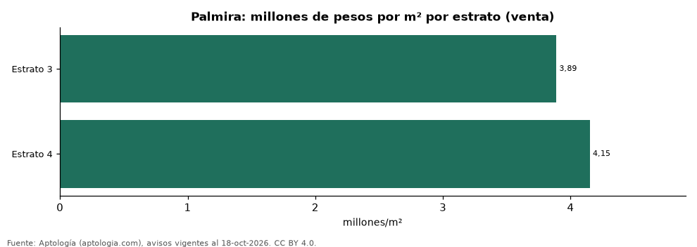

# Vivienda en Palmira: precio por m², arriendo, habitaciones, estrato y administración (octubre 2026)

**Un apartamento de 2 habitaciones en Palmira se pide en 245 millones de pesos en venta y se arrienda por 1,10 millones de pesos al mes en la mediana.** La rentabilidad bruta implícita del arriendo es 6,3 % anual.

*Resumen: analizamos 172 avisos de apartamentos en Palmira (124 en venta y 48 en arriendo).*

**Actualizado:** 18 de octubre de 2026 (datos del 18 de octubre de 2026) · **Próxima actualización:** mensual.

## Resumen

| Indicador | Valor |
|---|---|
| Venta por m² (mediana) | 4,19 millones de pesos |
| Arriendo 2 habitaciones | 1,10 millones de pesos |
| Rentabilidad bruta implícita | 6,3 % |
| Avisos | 172 |

## Precio por número de habitaciones

| Habitaciones | Precio de venta (mediana) | Arriendo mensual (mediana) | Avisos (venta / arriendo) |
|---|---|---|---|
| 2 | 245 millones de pesos | 1,10 millones de pesos | 57 / 31 |
| 3 o más | 350 millones de pesos | — | 67 / — |

## Por estrato

| Estrato | Venta por m² (millones) | Arriendo mensual (millones) | Avisos (venta / arriendo) |
|---|---|---|---|
| 3 | 3,89 | 1,10 | 44 / 37 |
| 4 | 4,15 | — | 42 / — |

Medianas; — indica menos de 30 avisos.

## Preguntas frecuentes

**¿Cuánto renta un apartamento en Palmira?**
La rentabilidad bruta implícita es 6,3 % anual (arriendo por m² × 12 ÷ precio de venta por m²), antes de gastos.

**¿Cuánto cuesta arrendar un apartamento de 2 habitaciones en Palmira?**
1,10 millones de pesos al mes en la mediana (octubre de 2026).

## Metodología

- **Fuente:** exportes nocturnos de la base de datos de Aptología (aptologia.com) del 18 de octubre de 2026: avisos vigentes de vivienda en portales inmobiliarios de 13 países, recogidos por Aptología y vistos en línea entre el 11 y el 18 de octubre de 2026. Corte: 18 de octubre de 2026.
- **Depuración:** se eliminan duplicados exactos (misma ciudad, zona, tipo, precio, moneda, área, habitaciones y baños) y los precios fuera del percentil 1–99 de cada país, operación, moneda y tipo; el precio por m² usa solo avisos con área declarada entre 12 y 2.000 m² y también se recorta al P1–P99.
- **Qué se mide:** precios pedidos (publicados), no precios de cierre. En arriendo, el canon mensual sin administración, gastos comunes ni condominio.
- **Muestra mínima:** cada cifra publicada se apoya en al menos 30 avisos; las celdas con menos se omiten.
- **Colombia:** Precios en pesos colombianos, sin conversión de moneda. Administración ÷ canon con razones entre 1 % y 80 %.
- **Limitaciones:** la cobertura depende de los portales que recorre Aptología en cada país y es mayor en las ciudades grandes y en los segmentos medio-alto y alto; el área es la que declara el aviso, sin verificar; los nombres de zona vienen de los portales.
- **Privacidad:** solo se publican agregados; no se publica ningún dato personal, enlace a avisos ni nombre de anunciante.
- **Datos abiertos:** [datos.csv](datos.csv), licencia CC BY 4.0.

## Cómo citar

Pinzón Pineda, D. M. (2026). *Vivienda en Palmira: precio por m², arriendo, habitaciones, estrato y administración (octubre 2026)*. Aptología (aptologia.com). https://github.com/elbroker/aptologia-datos/tree/main/estudios/vivienda-palmira-venta-arriendo-estrato-2026. Datos: datos.csv, licencia CC BY 4.0.
