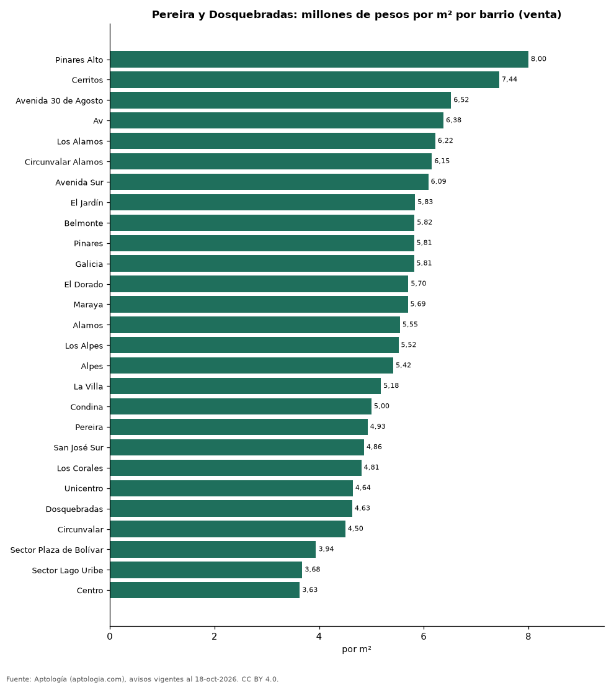
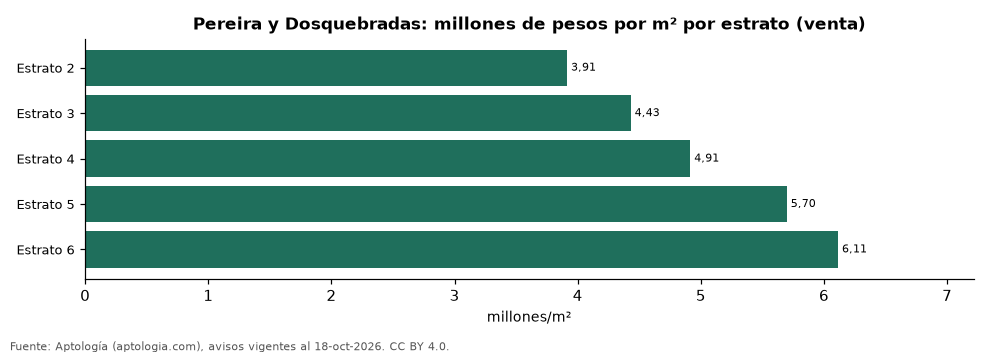

# Vivienda en Pereira y Dosquebradas: precio por m², arriendo, habitaciones, estrato y administración (octubre 2026)

**El barrio con el metro cuadrado más caro de Pereira y Dosquebradas es Pinares Alto, con 8,00 millones de pesos en la mediana de apartamentos en venta; el más barato de la muestra es Centro, con 3,63 millones de pesos.** Un apartamento de 2 habitaciones se arrienda por 2,60 millones de pesos al mes en la mediana y se vende por 382 millones de pesos. La rentabilidad bruta implícita del arriendo es 7,5 % anual. La administración equivale al 15,1 % del canon (400.000 pesos al mes en la mediana).

*Resumen: analizamos 6.695 avisos de apartamentos en Pereira y Dosquebradas (5.064 en venta y 1.631 en arriendo).*

**Actualizado:** 18 de octubre de 2026 (datos del 18 de octubre de 2026) · **Próxima actualización:** mensual.

## Resumen

| Indicador | Valor |
|---|---|
| Más caro (venta por m²) | Pinares Alto: 8,00 millones de pesos |
| Más barato (venta por m²) | Centro: 3,63 millones de pesos |
| Venta por m² (mediana) | 5,33 millones de pesos |
| Arriendo 2 habitaciones | 2,60 millones de pesos |
| Rentabilidad bruta implícita | 7,5 % |
| Administración / canon (mediana) | 15,1 % |
| Avisos | 6.695 |

## Barrios (30 avisos o más)

| Barrio | Venta por m² (millones de pesos) | Arriendo mensual (millones de pesos) | Avisos (venta / arriendo) |
|---|---|---|---|
| Pinares Alto | 8,00 | 4,80 | 57 / 53 |
| Cerritos | 7,44 | 3,90 | 400 / 163 |
| Avenida 30 de Agosto | 6,52 | — | 57 / — |
| Av | 6,38 | — | 47 / — |
| Los Alamos | 6,22 | 3,26 | 141 / 67 |
| Circunvalar Alamos | 6,15 | — | 32 / — |
| Avenida Sur | 6,09 | — | 87 / — |
| El Jardín | 5,83 | — | 30 / — |
| Belmonte | 5,82 | — | 60 / — |
| Pinares | 5,81 | 3,50 | 672 / 338 |
| Galicia | 5,81 | 2,20 | 166 / 89 |
| El Dorado | 5,70 | — | 60 / — |
| Maraya | 5,69 | — | 70 / — |
| Alamos | 5,55 | 2,75 | 274 / 183 |
| Los Alpes | 5,52 | 3,10 | 136 / 97 |
| Alpes | 5,42 | — | 35 / — |
| La Villa | 5,18 | — | 40 / — |
| Condina | 5,00 | 1,65 | 177 / 63 |
| Pereira | 4,93 | — | 42 / — |
| San José Sur | 4,86 | 3,30 | 49 / 35 |
| Los Corales | 4,81 | 1,70 | 47 / 30 |
| Unicentro | 4,64 | — | 37 / — |
| Dosquebradas | 4,63 | 1,62 | 610 / 70 |
| Circunvalar | 4,50 | 2,65 | 99 / 35 |
| Sector Plaza de Bolívar | 3,94 | — | 59 / — |
| Sector Lago Uribe | 3,68 | — | 31 / — |
| Centro | 3,63 | — | 201 / — |

Medianas de apartamentos; — indica menos de 30 avisos. El canon es mensual, sin administración ni gastos comunes.

## Precio por número de habitaciones

| Habitaciones | Precio de venta (mediana) | Arriendo mensual (mediana) | Avisos (venta / arriendo) |
|---|---|---|---|
| 1 | 360 millones de pesos | 1,95 millones de pesos | 155 / 87 |
| 2 | 382 millones de pesos | 2,60 millones de pesos | 1.391 / 556 |
| 3 o más | 430 millones de pesos | 3,00 millones de pesos | 3.507 / 983 |

## Por estrato

| Estrato | Venta por m² (millones) | Arriendo mensual (millones) | Avisos (venta / arriendo) |
|---|---|---|---|
| 2 | 3,91 | — | 67 / — |
| 3 | 4,43 | 1,59 | 528 / 52 |
| 4 | 4,91 | 1,90 | 1.145 / 220 |
| 5 | 5,70 | 2,40 | 1.327 / 414 |
| 6 | 6,11 | 3,30 | 1.825 / 919 |

Medianas; — indica menos de 30 avisos.

## Preguntas frecuentes

**¿Cuál es el barrio más caro de Pereira y Dosquebradas?**
Pinares Alto, con 8,00 millones de pesos por m² en apartamentos en venta (octubre de 2026).

**¿Dónde es más barato comprar apartamento en Pereira y Dosquebradas?**
Entre los barrios con 30 avisos o más, en Centro: 3,63 millones de pesos por m².

**¿Cuánto renta un apartamento en Pereira y Dosquebradas?**
La rentabilidad bruta implícita es 7,5 % anual (arriendo por m² × 12 ÷ precio de venta por m²), antes de gastos.

**¿Cuánto cuesta arrendar un apartamento de 2 habitaciones en Pereira y Dosquebradas?**
2,60 millones de pesos al mes en la mediana (octubre de 2026).

## Metodología

- **Fuente:** exportes nocturnos de la base de datos de Aptología (aptologia.com) del 18 de octubre de 2026: avisos vigentes de vivienda en portales inmobiliarios de 13 países, recogidos por Aptología y vistos en línea entre el 11 y el 18 de octubre de 2026. Corte: 18 de octubre de 2026.
- **Depuración:** se eliminan duplicados exactos (misma ciudad, zona, tipo, precio, moneda, área, habitaciones y baños) y los precios fuera del percentil 1–99 de cada país, operación, moneda y tipo; el precio por m² usa solo avisos con área declarada entre 12 y 2.000 m² y también se recorta al P1–P99.
- **Qué se mide:** precios pedidos (publicados), no precios de cierre. En arriendo, el canon mensual sin administración, gastos comunes ni condominio.
- **Muestra mínima:** cada cifra publicada se apoya en al menos 30 avisos; las celdas con menos se omiten.
- **Colombia:** Precios en pesos colombianos, sin conversión de moneda. Administración ÷ canon con razones entre 1 % y 80 %.
- **Área:** Pereira, Dosquebradas; los municipios distintos de Pereira aparecen como una zona propia.
- **Limitaciones:** la cobertura depende de los portales que recorre Aptología en cada país y es mayor en las ciudades grandes y en los segmentos medio-alto y alto; el área es la que declara el aviso, sin verificar; los nombres de zona vienen de los portales.
- **Privacidad:** solo se publican agregados; no se publica ningún dato personal, enlace a avisos ni nombre de anunciante.
- **Datos abiertos:** [datos.csv](datos.csv), licencia CC BY 4.0.

## Cómo citar

Pinzón Pineda, D. M. (2026). *Vivienda en Pereira y Dosquebradas: precio por m², arriendo, habitaciones, estrato y administración (octubre 2026)*. Aptología (aptologia.com). https://github.com/elbroker/aptologia-datos/tree/main/estudios/vivienda-pereira-dosquebradas-venta-arriendo-2026. Datos: datos.csv, licencia CC BY 4.0.
