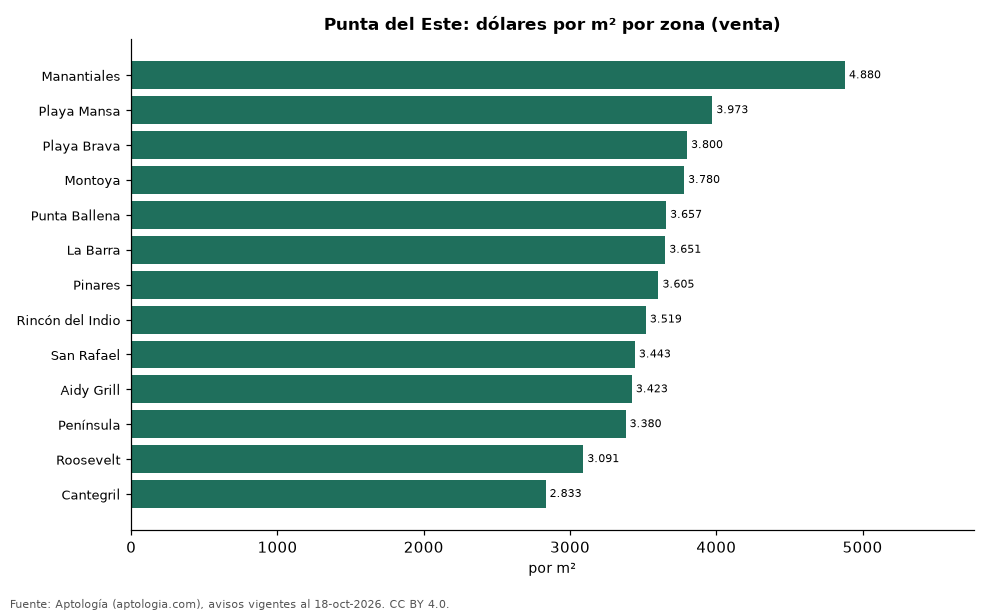

# Vivienda en Punta del Este: precio por m², arriendo, habitaciones y rentabilidad (octubre 2026)

**La zona con el metro cuadrado más caro de Punta del Este es Manantiales, con USD 4.880 en la mediana de departamentos en venta; la más barata de la muestra es Cantegril, con USD 2.833.** Un departamento de 2 habitaciones se arrienda por USD 3.800 al mes en la mediana y se vende por USD 310.000. La rentabilidad bruta implícita del arriendo es 13,7 % anual.

*Resumen: analizamos 7.662 avisos de departamentos en Punta del Este (5.198 en venta y 2.464 en arriendo).*

**Actualizado:** 18 de octubre de 2026 (datos del 18 de octubre de 2026) · **Próxima actualización:** mensual.

## Resumen

| Indicador | Valor |
|---|---|
| Más cara (venta por m²) | Manantiales: USD 4.880 |
| Más barata (venta por m²) | Cantegril: USD 2.833 |
| Venta por m² (mediana) | USD 3.604 |
| Arriendo 2 habitaciones | USD 3.800 |
| Rentabilidad bruta implícita | 13,7 % |
| Avisos | 7.662 |

## Zonas (30 avisos o más)

| Zona | Venta por m² (dólares) | Arriendo mensual (dólares) | Avisos (venta / arriendo) |
|---|---|---|---|
| Manantiales | 4.880 | 10.000 | 101 / 86 |
| Playa Mansa | 3.973 | 5.200 | 1.075 / 624 |
| Playa Brava | 3.800 | 6.600 | 1.082 / 625 |
| Montoya | 3.780 | 12.750 | 36 / 40 |
| Punta Ballena | 3.657 | 5.550 | 128 / 47 |
| La Barra | 3.651 | 6.950 | 159 / 106 |
| Pinares | 3.605 | — | 92 / — |
| Rincón del Indio | 3.519 | 8.300 | 83 / 41 |
| San Rafael | 3.443 | 1.900 | 87 / 41 |
| Aidy Grill | 3.423 | 2.600 | 300 / 193 |
| Península | 3.380 | 3.200 | 535 / 267 |
| Roosevelt | 3.091 | 2.500 | 491 / 193 |
| Cantegril | 2.833 | — | 67 / — |

Medianas de apartamentos; — indica menos de 30 avisos. El canon es mensual, sin administración ni gastos comunes.

## Precio por número de habitaciones

| Habitaciones | Precio de venta (mediana) | Arriendo mensual (mediana) | Avisos (venta / arriendo) |
|---|---|---|---|
| 1 | USD 185.000 | USD 2.550 | 906 / 402 |
| 2 | USD 310.000 | USD 3.800 | 1.988 / 957 |
| 3 o más | USD 600.000 | USD 6.820 | 2.304 / 1.105 |

## Preguntas frecuentes

**¿Cuál es la zona más cara de Punta del Este?**
Manantiales, con USD 4.880 por m² en departamentos en venta (octubre de 2026).

**¿Dónde es más barato comprar apartamento en Punta del Este?**
Entre las zonas con 30 avisos o más, en Cantegril: USD 2.833 por m².

**¿Cuánto renta un departamento en Punta del Este?**
La rentabilidad bruta implícita es 13,7 % anual (arriendo por m² × 12 ÷ precio de venta por m²), antes de gastos.

**¿Cuánto cuesta arrendar un departamento de 2 habitaciones en Punta del Este?**
USD 3.800 al mes en la mediana (octubre de 2026).

## Metodología

- **Fuente:** exportes nocturnos de la base de datos de Aptología (aptologia.com) del 18 de octubre de 2026: avisos vigentes de vivienda en portales inmobiliarios de 13 países, recogidos por Aptología y vistos en línea entre el 11 y el 18 de octubre de 2026. Corte: 18 de octubre de 2026.
- **Depuración:** se eliminan duplicados exactos (misma ciudad, zona, tipo, precio, moneda, área, habitaciones y baños) y los precios fuera del percentil 1–99 de cada país, operación, moneda y tipo; el precio por m² usa solo avisos con área declarada entre 12 y 2.000 m² y también se recorta al P1–P99.
- **Qué se mide:** precios pedidos (publicados), no precios de cierre. En arriendo, el canon mensual sin administración, gastos comunes ni condominio.
- **Muestra mínima:** cada cifra publicada se apoya en al menos 30 avisos; las celdas con menos se omiten.
- **Monedas:** nunca se mezclan avisos de monedas distintas sin convertirlos. Conversión a dólares con la tasa de mercado de ExchangeRate-API (open.er-api.com, actualización del 18 Oct 2026): 1 USD = 3.182,80 COP, 1 USD = 18,47 M.N, 1 USD = 5,09 BRL, 1 USD = 3,44 PEN, 1 USD = 982,44 CLP, 1 USD = 1.514,57 ARS, 1 USD = 40,20 UYU, 1 USD = 5.705,37 PYG, 1 USD = 61,27 DOP, 1 USD = 0,89 EUR, 1 USD = 11,72 BOB; la UF chilena a 41.178,64 CLP (mindicador,cl. 18-oct-2026). Los avisos publicados en dólares se usan tal cual.
- **Monedas:** venta en dólares y arriendo en dólares, la moneda mayoritaria de cada operación; los avisos en otra moneda se excluyen. Equivalencias en dólares con la tasa citada.
- **Limitaciones:** la cobertura depende de los portales que recorre Aptología en cada país y es mayor en las ciudades grandes y en los segmentos medio-alto y alto; el área es la que declara el aviso, sin verificar; los nombres de zona vienen de los portales.
- **Privacidad:** solo se publican agregados; no se publica ningún dato personal, enlace a avisos ni nombre de anunciante.
- **Datos abiertos:** [datos.csv](datos.csv), licencia CC BY 4.0.

## Cómo citar

Pinzón Pineda, D. M. (2026). *Vivienda en Punta del Este: precio por m², arriendo, habitaciones y rentabilidad (octubre 2026)*. Aptología (aptologia.com). https://github.com/elbroker/aptologia-datos/tree/main/estudios/vivienda-punta-del-este-por-zona-2026. Datos: datos.csv, licencia CC BY 4.0.
