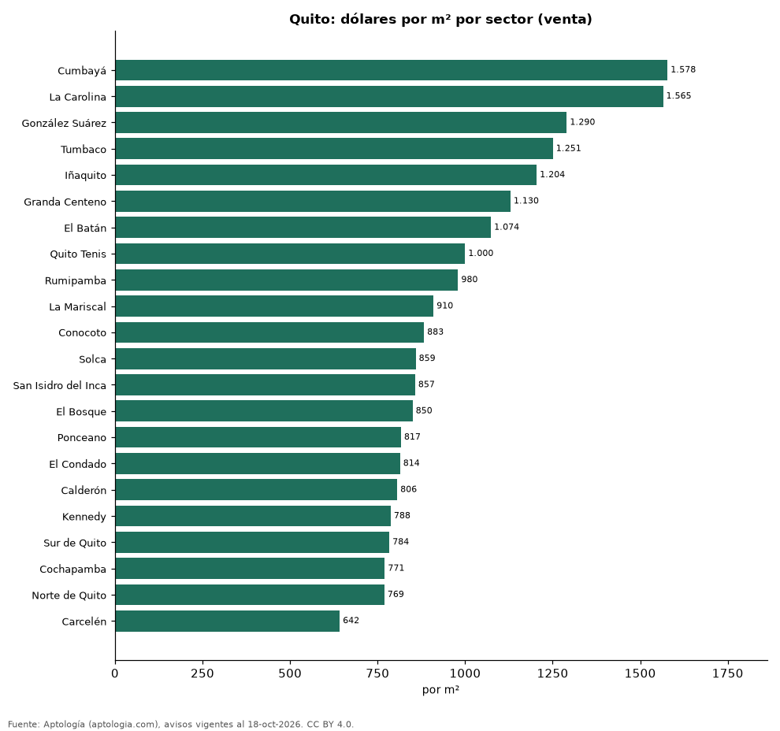

# Vivienda en Quito: precio por m², arriendo, habitaciones y rentabilidad (octubre 2026)

**El sector con el metro cuadrado más caro de Quito es Cumbayá, con USD 1.578 en la mediana de departamentos en venta; el más barato de la muestra es Carcelén, con USD 642.** Un departamento de 2 habitaciones se arrienda por USD 900 al mes en la mediana y se vende por USD 139.000. La rentabilidad bruta implícita del arriendo es 8,7 % anual.

*Resumen: analizamos 3.644 avisos de departamentos en Quito (2.337 en venta y 1.307 en arriendo).*

**Actualizado:** 18 de octubre de 2026 (datos del 18 de octubre de 2026) · **Próxima actualización:** mensual.

## Resumen

| Indicador | Valor |
|---|---|
| Más caro (venta por m²) | Cumbayá: USD 1.578 |
| Más barato (venta por m²) | Carcelén: USD 642 |
| Venta por m² (mediana) | USD 1.000 |
| Arriendo 2 habitaciones | USD 900 |
| Rentabilidad bruta implícita | 8,7 % |
| Avisos | 3.644 |

## Sectores (30 avisos o más)

| Sector | Venta por m² (dólares) | Arriendo mensual (dólares) | Avisos (venta / arriendo) |
|---|---|---|---|
| Cumbayá | 1.578 | 1.500 | 223 / 42 |
| La Carolina | 1.565 | 1.030 | 153 / 35 |
| González Suárez | 1.290 | 1.700 | 129 / 30 |
| Tumbaco | 1.251 | — | 95 / — |
| Iñaquito | 1.204 | — | 194 / — |
| Granda Centeno | 1.130 | — | 41 / — |
| El Batán | 1.074 | — | 69 / — |
| Quito Tenis | 1.000 | — | 147 / — |
| Rumipamba | 980 | — | 42 / — |
| La Mariscal | 910 | — | 34 / — |
| Conocoto | 883 | — | 69 / — |
| Solca | 859 | — | 37 / — |
| San Isidro del Inca | 857 | — | 49 / — |
| El Bosque | 850 | — | 61 / — |
| Ponceano | 817 | — | 100 / — |
| El Condado | 814 | — | 101 / — |
| Calderón | 806 | — | 35 / — |
| Kennedy | 788 | — | 70 / — |
| Sur de Quito | 784 | — | 48 / — |
| Cochapamba | 771 | — | 35 / — |
| Norte de Quito | 769 | — | 50 / — |
| Carcelén | 642 | — | 48 / — |

Medianas de apartamentos; — indica menos de 30 avisos. El canon es mensual, sin administración ni gastos comunes.

## Precio por número de habitaciones

| Habitaciones | Precio de venta (mediana) | Arriendo mensual (mediana) | Avisos (venta / arriendo) |
|---|---|---|---|
| 1 | USD 122.500 | USD 550 | 57 / 182 |
| 2 | USD 139.000 | USD 900 | 758 / 512 |
| 3 o más | USD 155.000 | USD 950 | 1.492 / 575 |

## Preguntas frecuentes

**¿Cuál es el sector más caro de Quito?**
Cumbayá, con USD 1.578 por m² en departamentos en venta (octubre de 2026).

**¿Dónde es más barato comprar apartamento en Quito?**
Entre los sectores con 30 avisos o más, en Carcelén: USD 642 por m².

**¿Cuánto renta un departamento en Quito?**
La rentabilidad bruta implícita es 8,7 % anual (arriendo por m² × 12 ÷ precio de venta por m²), antes de gastos.

**¿Cuánto cuesta arrendar un departamento de 2 habitaciones en Quito?**
USD 900 al mes en la mediana (octubre de 2026).

## Metodología

- **Fuente:** exportes nocturnos de la base de datos de Aptología (aptologia.com) del 18 de octubre de 2026: avisos vigentes de vivienda en portales inmobiliarios de 13 países, recogidos por Aptología y vistos en línea entre el 11 y el 18 de octubre de 2026. Corte: 18 de octubre de 2026.
- **Depuración:** se eliminan duplicados exactos (misma ciudad, zona, tipo, precio, moneda, área, habitaciones y baños) y los precios fuera del percentil 1–99 de cada país, operación, moneda y tipo; el precio por m² usa solo avisos con área declarada entre 12 y 2.000 m² y también se recorta al P1–P99.
- **Qué se mide:** precios pedidos (publicados), no precios de cierre. En arriendo, el canon mensual sin administración, gastos comunes ni condominio.
- **Muestra mínima:** cada cifra publicada se apoya en al menos 30 avisos; las celdas con menos se omiten.
- **Monedas:** nunca se mezclan avisos de monedas distintas sin convertirlos. Conversión a dólares con la tasa de mercado de ExchangeRate-API (open.er-api.com, actualización del 18 Oct 2026): 1 USD = 3.182,80 COP, 1 USD = 18,47 M.N, 1 USD = 5,09 BRL, 1 USD = 3,44 PEN, 1 USD = 982,44 CLP, 1 USD = 1.514,57 ARS, 1 USD = 40,20 UYU, 1 USD = 5.705,37 PYG, 1 USD = 61,27 DOP, 1 USD = 0,89 EUR, 1 USD = 11,72 BOB; la UF chilena a 41.178,64 CLP (mindicador,cl. 18-oct-2026). Los avisos publicados en dólares se usan tal cual.
- **Monedas:** venta en dólares y arriendo en dólares, la moneda mayoritaria de cada operación; los avisos en otra moneda se excluyen. Equivalencias en dólares con la tasa citada.
- **Limitaciones:** la cobertura depende de los portales que recorre Aptología en cada país y es mayor en las ciudades grandes y en los segmentos medio-alto y alto; el área es la que declara el aviso, sin verificar; los nombres de zona vienen de los portales.
- **Privacidad:** solo se publican agregados; no se publica ningún dato personal, enlace a avisos ni nombre de anunciante.
- **Datos abiertos:** [datos.csv](datos.csv), licencia CC BY 4.0.

## Cómo citar

Pinzón Pineda, D. M. (2026). *Vivienda en Quito: precio por m², arriendo, habitaciones y rentabilidad (octubre 2026)*. Aptología (aptologia.com). https://github.com/elbroker/aptologia-datos/tree/main/estudios/vivienda-quito-por-sector-2026. Datos: datos.csv, licencia CC BY 4.0.
