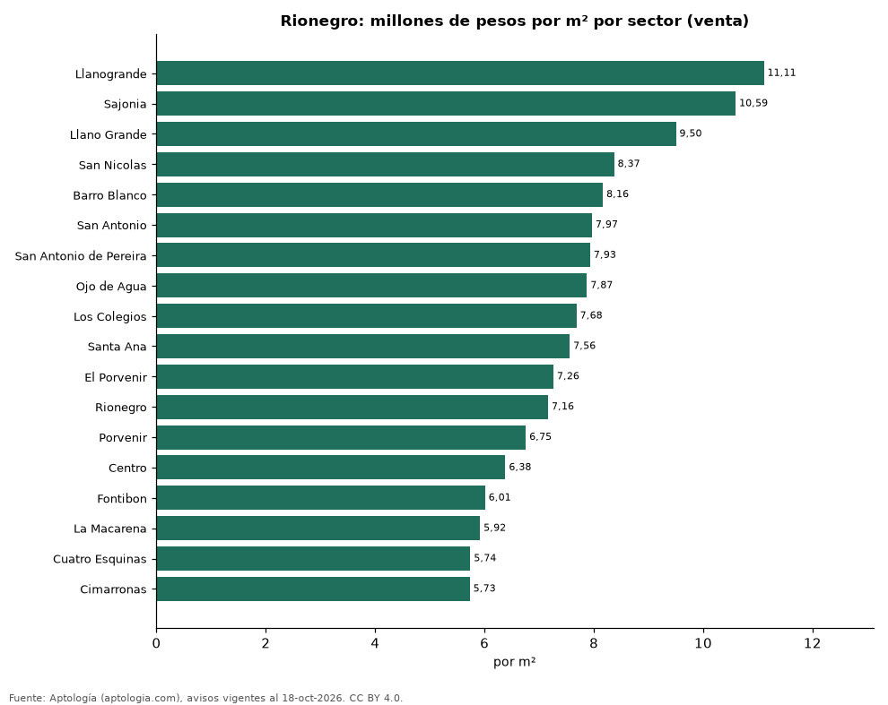
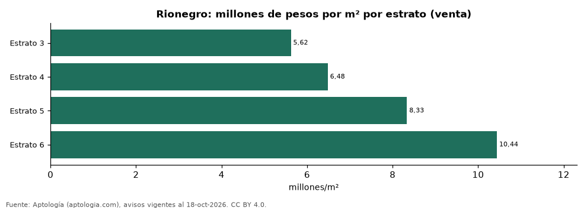

# Vivienda en Rionegro: precio por m², arriendo, habitaciones, estrato y administración (octubre 2026)

**El sector con el metro cuadrado más caro de Rionegro es Llanogrande, con 11,11 millones de pesos en la mediana de apartamentos en venta; el más barato de la muestra es Cimarronas, con 5,73 millones de pesos.** Un apartamento de 2 habitaciones se arrienda por 2,60 millones de pesos al mes en la mediana y se vende por 500 millones de pesos. La rentabilidad bruta implícita del arriendo es 6,1 % anual. La administración equivale al 12,0 % del canon (335.000 pesos al mes en la mediana).

*Resumen: analizamos 6.249 avisos de apartamentos en Rionegro (3.052 en venta y 3.197 en arriendo).*

**Actualizado:** 18 de octubre de 2026 (datos del 18 de octubre de 2026) · **Próxima actualización:** mensual.

## Resumen

| Indicador | Valor |
|---|---|
| Más caro (venta por m²) | Llanogrande: 11,11 millones de pesos |
| Más barato (venta por m²) | Cimarronas: 5,73 millones de pesos |
| Venta por m² (mediana) | 7,44 millones de pesos |
| Arriendo 2 habitaciones | 2,60 millones de pesos |
| Rentabilidad bruta implícita | 6,1 % |
| Administración / canon (mediana) | 12,0 % |
| Avisos | 6.249 |

## Sectores (30 avisos o más)

| Sector | Venta por m² (millones de pesos) | Arriendo mensual (millones de pesos) | Avisos (venta / arriendo) |
|---|---|---|---|
| Llanogrande | 11,11 | 5,75 | 58 / 72 |
| Sajonia | 10,59 | 6,00 | 63 / 79 |
| Llano Grande | 9,50 | 3,50 | 177 / 220 |
| San Nicolas | 8,37 | 2,90 | 31 / 54 |
| Barro Blanco | 8,16 | 2,80 | 223 / 204 |
| San Antonio | 7,97 | 2,60 | 78 / 129 |
| San Antonio de Pereira | 7,93 | 2,70 | 201 / 147 |
| Ojo de Agua | 7,87 | 2,70 | 62 / 67 |
| Los Colegios | 7,68 | 2,60 | 100 / 208 |
| Santa Ana | 7,56 | 2,60 | 92 / 141 |
| El Porvenir | 7,26 | 2,60 | 415 / 469 |
| Rionegro | 7,16 | 2,90 | 282 / 287 |
| Porvenir | 6,75 | 2,30 | 30 / 34 |
| Centro | 6,38 | 2,30 | 104 / 153 |
| Fontibon | 6,01 | 1,70 | 260 / 127 |
| La Macarena | 5,92 | — | 32 / — |
| Cuatro Esquinas | 5,74 | 1,60 | 55 / 43 |
| Cimarronas | 5,73 | 1,60 | 51 / 81 |
| El Faro | — | 2,50 | — / 41 |

Medianas de apartamentos; — indica menos de 30 avisos. El canon es mensual, sin administración ni gastos comunes.

## Precio por número de habitaciones

| Habitaciones | Precio de venta (mediana) | Arriendo mensual (mediana) | Avisos (venta / arriendo) |
|---|---|---|---|
| 1 | 518 millones de pesos | 3,00 millones de pesos | 154 / 229 |
| 2 | 500 millones de pesos | 2,60 millones de pesos | 1.636 / 1.750 |
| 3 o más | 540 millones de pesos | 2,70 millones de pesos | 1.256 / 1.213 |

## Por estrato

| Estrato | Venta por m² (millones) | Arriendo mensual (millones) | Avisos (venta / arriendo) |
|---|---|---|---|
| 3 | 5,62 | 1,70 | 372 / 252 |
| 4 | 6,48 | 2,00 | 1.159 / 1.098 |
| 5 | 8,33 | 2,90 | 1.128 / 1.617 |
| 6 | 10,44 | 5,30 | 194 / 200 |

Medianas; — indica menos de 30 avisos.

## Preguntas frecuentes

**¿Cuál es el sector más caro de Rionegro?**
Llanogrande, con 11,11 millones de pesos por m² en apartamentos en venta (octubre de 2026).

**¿Dónde es más barato comprar apartamento en Rionegro?**
Entre los sectores con 30 avisos o más, en Cimarronas: 5,73 millones de pesos por m².

**¿Cuánto renta un apartamento en Rionegro?**
La rentabilidad bruta implícita es 6,1 % anual (arriendo por m² × 12 ÷ precio de venta por m²), antes de gastos.

**¿Cuánto cuesta arrendar un apartamento de 2 habitaciones en Rionegro?**
2,60 millones de pesos al mes en la mediana (octubre de 2026).

## Metodología

- **Fuente:** exportes nocturnos de la base de datos de Aptología (aptologia.com) del 18 de octubre de 2026: avisos vigentes de vivienda en portales inmobiliarios de 13 países, recogidos por Aptología y vistos en línea entre el 11 y el 18 de octubre de 2026. Corte: 18 de octubre de 2026.
- **Depuración:** se eliminan duplicados exactos (misma ciudad, zona, tipo, precio, moneda, área, habitaciones y baños) y los precios fuera del percentil 1–99 de cada país, operación, moneda y tipo; el precio por m² usa solo avisos con área declarada entre 12 y 2.000 m² y también se recorta al P1–P99.
- **Qué se mide:** precios pedidos (publicados), no precios de cierre. En arriendo, el canon mensual sin administración, gastos comunes ni condominio.
- **Muestra mínima:** cada cifra publicada se apoya en al menos 30 avisos; las celdas con menos se omiten.
- **Colombia:** Precios en pesos colombianos, sin conversión de moneda. Administración ÷ canon con razones entre 1 % y 80 %.
- **Limitaciones:** la cobertura depende de los portales que recorre Aptología en cada país y es mayor en las ciudades grandes y en los segmentos medio-alto y alto; el área es la que declara el aviso, sin verificar; los nombres de zona vienen de los portales.
- **Privacidad:** solo se publican agregados; no se publica ningún dato personal, enlace a avisos ni nombre de anunciante.
- **Datos abiertos:** [datos.csv](datos.csv), licencia CC BY 4.0.

## Cómo citar

Pinzón Pineda, D. M. (2026). *Vivienda en Rionegro: precio por m², arriendo, habitaciones, estrato y administración (octubre 2026)*. Aptología (aptologia.com). https://github.com/elbroker/aptologia-datos/tree/main/estudios/vivienda-rionegro-venta-rentabilidad-estrato-2026. Datos: datos.csv, licencia CC BY 4.0.
