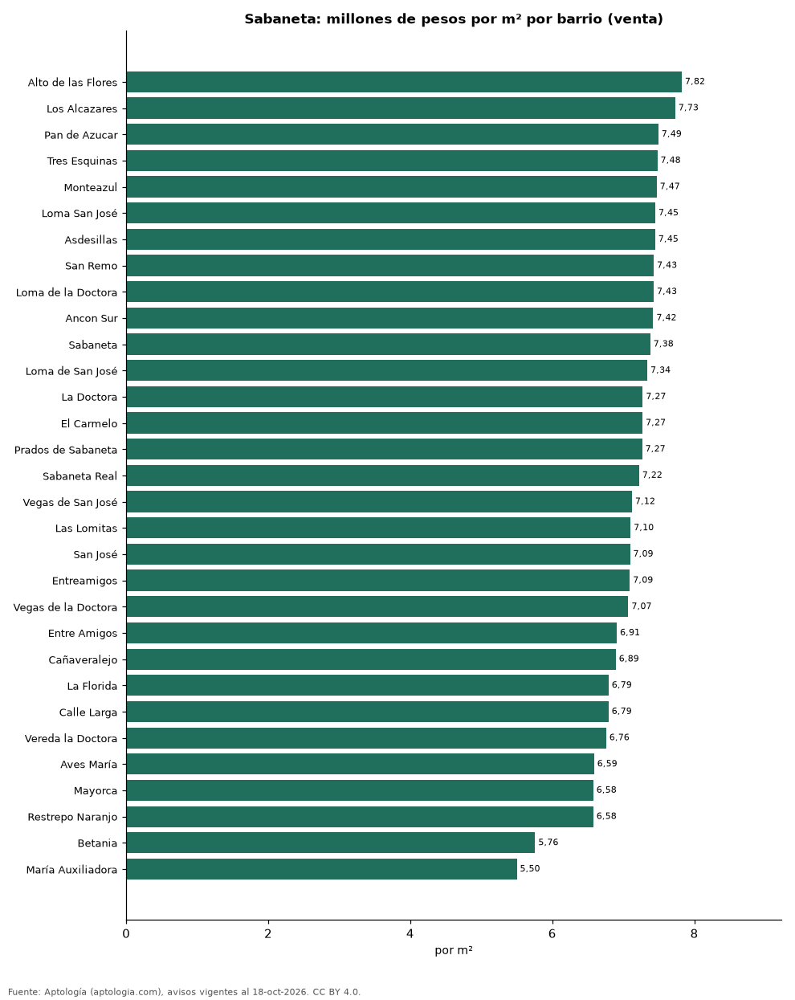
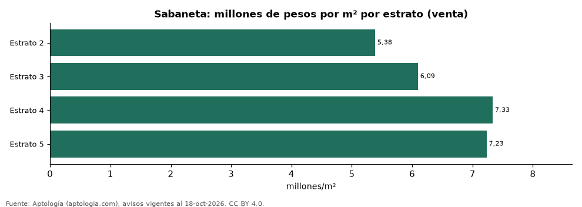

# Vivienda en Sabaneta: precio por m², arriendo, habitaciones, estrato y administración (octubre 2026)

**El barrio con el metro cuadrado más caro de Sabaneta es Alto de las Flores, con 7,82 millones de pesos en la mediana de apartamentos en venta; el más barato de la muestra es María Auxiliadora, con 5,50 millones de pesos.** Un apartamento de 2 habitaciones se arrienda por 2,90 millones de pesos al mes en la mediana y se vende por 511 millones de pesos. La rentabilidad bruta implícita del arriendo es 6,9 % anual. La administración equivale al 11,5 % del canon (380.000 pesos al mes en la mediana).

*Resumen: analizamos 8.283 avisos de apartamentos en Sabaneta (4.393 en venta y 3.890 en arriendo).*

**Actualizado:** 18 de octubre de 2026 (datos del 18 de octubre de 2026) · **Próxima actualización:** mensual.

## Resumen

| Indicador | Valor |
|---|---|
| Más caro (venta por m²) | Alto de las Flores: 7,82 millones de pesos |
| Más barato (venta por m²) | María Auxiliadora: 5,50 millones de pesos |
| Venta por m² (mediana) | 7,12 millones de pesos |
| Arriendo 2 habitaciones | 2,90 millones de pesos |
| Rentabilidad bruta implícita | 6,9 % |
| Administración / canon (mediana) | 11,5 % |
| Avisos | 8.283 |

## Barrios (30 avisos o más)

| Barrio | Venta por m² (millones de pesos) | Arriendo mensual (millones de pesos) | Avisos (venta / arriendo) |
|---|---|---|---|
| Alto de las Flores | 7,82 | — | 38 / — |
| Los Alcazares | 7,73 | 2,95 | 45 / 46 |
| Pan de Azucar | 7,49 | 3,10 | 183 / 132 |
| Tres Esquinas | 7,48 | 2,95 | 84 / 55 |
| Monteazul | 7,47 | 3,05 | 122 / 175 |
| Loma San José | 7,45 | 3,10 | 63 / 37 |
| Asdesillas | 7,45 | 3,10 | 64 / 49 |
| San Remo | 7,43 | 3,30 | 86 / 41 |
| Loma de la Doctora | 7,43 | 3,10 | 97 / 107 |
| Ancon Sur | 7,42 | — | 34 / — |
| Sabaneta | 7,38 | 3,66 | 258 / 347 |
| Loma de San José | 7,34 | 3,00 | 130 / 71 |
| La Doctora | 7,27 | 2,95 | 302 / 169 |
| El Carmelo | 7,27 | 3,00 | 52 / 35 |
| Prados de Sabaneta | 7,27 | 3,10 | 56 / 130 |
| Sabaneta Real | 7,22 | 3,00 | 81 / 44 |
| Vegas de San José | 7,12 | 3,30 | 32 / 40 |
| Las Lomitas | 7,10 | 3,40 | 505 / 345 |
| San José | 7,09 | 3,10 | 338 / 231 |
| Entreamigos | 7,09 | 2,87 | 136 / 148 |
| Vegas de la Doctora | 7,07 | 3,65 | 67 / 107 |
| Entre Amigos | 6,91 | 2,85 | 38 / 46 |
| Cañaveralejo | 6,89 | 2,90 | 98 / 97 |
| La Florida | 6,79 | 2,90 | 61 / 83 |
| Calle Larga | 6,79 | 2,70 | 132 / 103 |
| Vereda la Doctora | 6,76 | 2,88 | 33 / 42 |
| Aves María | 6,59 | 3,50 | 312 / 217 |
| Mayorca | 6,58 | 3,20 | 73 / 149 |
| Restrepo Naranjo | 6,58 | — | 32 / — |
| Betania | 5,76 | — | 48 / — |
| María Auxiliadora | 5,50 | 2,00 | 127 / 96 |
| Aldea Verde | — | 2,88 | — / 34 |
| Holanda | — | 2,70 | — / 35 |
| La Barquereña | — | 3,55 | — / 40 |
| Santa Ana | — | 2,40 | — / 38 |
| Vereda Pan de Azucar | — | 3,20 | — / 37 |
| Vereda San José | — | 3,10 | — / 51 |

Medianas de apartamentos; — indica menos de 30 avisos. El canon es mensual, sin administración ni gastos comunes.

## Precio por número de habitaciones

| Habitaciones | Precio de venta (mediana) | Arriendo mensual (mediana) | Avisos (venta / arriendo) |
|---|---|---|---|
| 1 | 388 millones de pesos | 2,50 millones de pesos | 108 / 121 |
| 2 | 511 millones de pesos | 2,90 millones de pesos | 1.392 / 1.301 |
| 3 o más | 580 millones de pesos | 3,30 millones de pesos | 2.891 / 2.462 |

## Por estrato

| Estrato | Venta por m² (millones) | Arriendo mensual (millones) | Avisos (venta / arriendo) |
|---|---|---|---|
| 2 | 5,38 | 2,05 | 153 / 83 |
| 3 | 6,09 | 2,37 | 702 / 576 |
| 4 | 7,33 | 3,20 | 3.025 / 2.990 |
| 5 | 7,23 | 3,50 | 268 / 203 |

Medianas; — indica menos de 30 avisos.

## Preguntas frecuentes

**¿Cuál es el barrio más caro de Sabaneta?**
Alto de las Flores, con 7,82 millones de pesos por m² en apartamentos en venta (octubre de 2026).

**¿Dónde es más barato comprar apartamento en Sabaneta?**
Entre los barrios con 30 avisos o más, en María Auxiliadora: 5,50 millones de pesos por m².

**¿Cuánto renta un apartamento en Sabaneta?**
La rentabilidad bruta implícita es 6,9 % anual (arriendo por m² × 12 ÷ precio de venta por m²), antes de gastos.

**¿Cuánto cuesta arrendar un apartamento de 2 habitaciones en Sabaneta?**
2,90 millones de pesos al mes en la mediana (octubre de 2026).

## Metodología

- **Fuente:** exportes nocturnos de la base de datos de Aptología (aptologia.com) del 18 de octubre de 2026: avisos vigentes de vivienda en portales inmobiliarios de 13 países, recogidos por Aptología y vistos en línea entre el 11 y el 18 de octubre de 2026. Corte: 18 de octubre de 2026.
- **Depuración:** se eliminan duplicados exactos (misma ciudad, zona, tipo, precio, moneda, área, habitaciones y baños) y los precios fuera del percentil 1–99 de cada país, operación, moneda y tipo; el precio por m² usa solo avisos con área declarada entre 12 y 2.000 m² y también se recorta al P1–P99.
- **Qué se mide:** precios pedidos (publicados), no precios de cierre. En arriendo, el canon mensual sin administración, gastos comunes ni condominio.
- **Muestra mínima:** cada cifra publicada se apoya en al menos 30 avisos; las celdas con menos se omiten.
- **Colombia:** Precios en pesos colombianos, sin conversión de moneda. Administración ÷ canon con razones entre 1 % y 80 %.
- **Limitaciones:** la cobertura depende de los portales que recorre Aptología en cada país y es mayor en las ciudades grandes y en los segmentos medio-alto y alto; el área es la que declara el aviso, sin verificar; los nombres de zona vienen de los portales.
- **Privacidad:** solo se publican agregados; no se publica ningún dato personal, enlace a avisos ni nombre de anunciante.
- **Datos abiertos:** [datos.csv](datos.csv), licencia CC BY 4.0.

## Cómo citar

Pinzón Pineda, D. M. (2026). *Vivienda en Sabaneta: precio por m², arriendo, habitaciones, estrato y administración (octubre 2026)*. Aptología (aptologia.com). https://github.com/elbroker/aptologia-datos/tree/main/estudios/vivienda-sabaneta-venta-arriendo-rentabilidad-2026. Datos: datos.csv, licencia CC BY 4.0.
