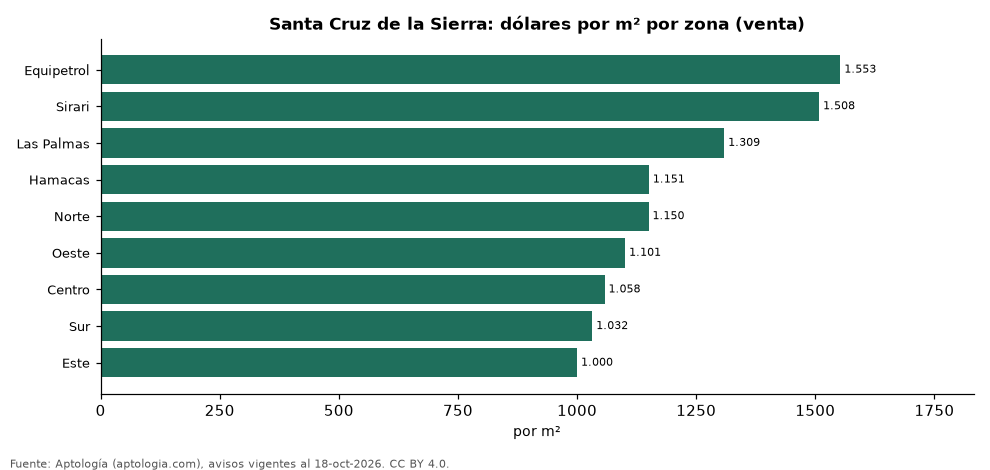

# Vivienda en Santa Cruz de la Sierra: precio por m², arriendo, habitaciones y rentabilidad (octubre 2026)

**La zona con el metro cuadrado más caro de Santa Cruz de la Sierra es Equipetrol, con USD 1.553 en la mediana de departamentos en venta; la más barata de la muestra es Este, con USD 1.000.** Un departamento de 2 habitaciones se arrienda por USD 630 al mes en la mediana y se vende por USD 105.000. La rentabilidad bruta implícita del arriendo es 7,0 % anual.

*Resumen: analizamos 2.927 avisos de departamentos en Santa Cruz de la Sierra (1.868 en venta y 1.059 en arriendo).*

**Actualizado:** 18 de octubre de 2026 (datos del 18 de octubre de 2026) · **Próxima actualización:** mensual.

## Resumen

| Indicador | Valor |
|---|---|
| Más cara (venta por m²) | Equipetrol: USD 1.553 |
| Más barata (venta por m²) | Este: USD 1.000 |
| Venta por m² (mediana) | USD 1.241 |
| Arriendo 2 habitaciones | USD 630 |
| Rentabilidad bruta implícita | 7,0 % |
| Avisos | 2.927 |

## Zonas (30 avisos o más)

| Zona | Venta por m² (dólares) | Arriendo mensual (dólares) | Avisos (venta / arriendo) |
|---|---|---|---|
| Equipetrol | 1.553 | 700 | 446 / 348 |
| Sirari | 1.508 | — | 46 / — |
| Las Palmas | 1.309 | 1.000 | 40 / 30 |
| Hamacas | 1.151 | — | 69 / — |
| Norte | 1.150 | 550 | 499 / 258 |
| Oeste | 1.101 | 590 | 189 / 118 |
| Centro | 1.058 | 500 | 109 / 114 |
| Sur | 1.032 | 525 | 104 / 52 |
| Este | 1.000 | — | 48 / — |

Medianas de apartamentos; — indica menos de 30 avisos. El canon es mensual, sin administración ni gastos comunes.

## Precio por número de habitaciones

| Habitaciones | Precio de venta (mediana) | Arriendo mensual (mediana) | Avisos (venta / arriendo) |
|---|---|---|---|
| 1 | USD 70.000 | USD 425 | 584 / 388 |
| 2 | USD 105.000 | USD 630 | 683 / 396 |
| 3 o más | USD 145.000 | USD 785 | 601 / 275 |

## Preguntas frecuentes

**¿Cuál es la zona más cara de Santa Cruz de la Sierra?**
Equipetrol, con USD 1.553 por m² en departamentos en venta (octubre de 2026).

**¿Dónde es más barato comprar apartamento en Santa Cruz de la Sierra?**
Entre las zonas con 30 avisos o más, en Este: USD 1.000 por m².

**¿Cuánto renta un departamento en Santa Cruz de la Sierra?**
La rentabilidad bruta implícita es 7,0 % anual (arriendo por m² × 12 ÷ precio de venta por m²), antes de gastos.

**¿Cuánto cuesta arrendar un departamento de 2 habitaciones en Santa Cruz de la Sierra?**
USD 630 al mes en la mediana (octubre de 2026).

## Metodología

- **Fuente:** exportes nocturnos de la base de datos de Aptología (aptologia.com) del 18 de octubre de 2026: avisos vigentes de vivienda en portales inmobiliarios de 13 países, recogidos por Aptología y vistos en línea entre el 11 y el 18 de octubre de 2026. Corte: 18 de octubre de 2026.
- **Depuración:** se eliminan duplicados exactos (misma ciudad, zona, tipo, precio, moneda, área, habitaciones y baños) y los precios fuera del percentil 1–99 de cada país, operación, moneda y tipo; el precio por m² usa solo avisos con área declarada entre 12 y 2.000 m² y también se recorta al P1–P99.
- **Qué se mide:** precios pedidos (publicados), no precios de cierre. En arriendo, el canon mensual sin administración, gastos comunes ni condominio.
- **Muestra mínima:** cada cifra publicada se apoya en al menos 30 avisos; las celdas con menos se omiten.
- **Monedas:** nunca se mezclan avisos de monedas distintas sin convertirlos. Conversión a dólares con la tasa de mercado de ExchangeRate-API (open.er-api.com, actualización del 18 Oct 2026): 1 USD = 3.182,80 COP, 1 USD = 18,47 M.N, 1 USD = 5,09 BRL, 1 USD = 3,44 PEN, 1 USD = 982,44 CLP, 1 USD = 1.514,57 ARS, 1 USD = 40,20 UYU, 1 USD = 5.705,37 PYG, 1 USD = 61,27 DOP, 1 USD = 0,89 EUR, 1 USD = 11,72 BOB; la UF chilena a 41.178,64 CLP (mindicador,cl. 18-oct-2026). Los avisos publicados en dólares se usan tal cual.
- **Monedas:** venta en dólares y arriendo en dólares, la moneda mayoritaria de cada operación; los avisos en otra moneda se excluyen. Equivalencias en dólares con la tasa citada.
- **Limitaciones:** la cobertura depende de los portales que recorre Aptología en cada país y es mayor en las ciudades grandes y en los segmentos medio-alto y alto; el área es la que declara el aviso, sin verificar; los nombres de zona vienen de los portales.
- **Privacidad:** solo se publican agregados; no se publica ningún dato personal, enlace a avisos ni nombre de anunciante.
- **Datos abiertos:** [datos.csv](datos.csv), licencia CC BY 4.0.

## Cómo citar

Pinzón Pineda, D. M. (2026). *Vivienda en Santa Cruz de la Sierra: precio por m², arriendo, habitaciones y rentabilidad (octubre 2026)*. Aptología (aptologia.com). https://github.com/elbroker/aptologia-datos/tree/main/estudios/vivienda-santa-cruz-de-la-sierra-por-zona-2026. Datos: datos.csv, licencia CC BY 4.0.
