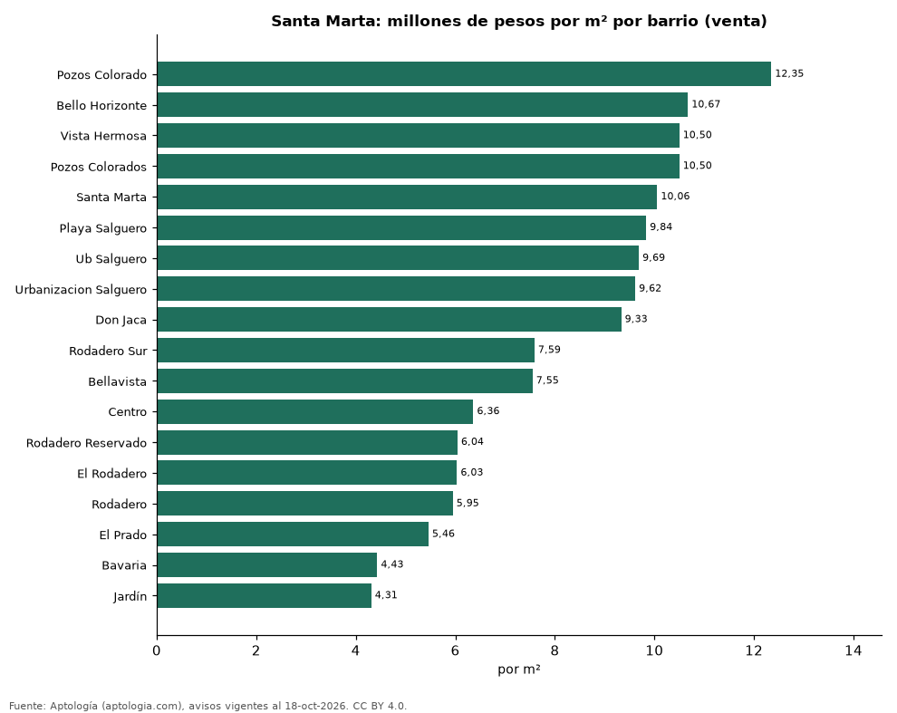
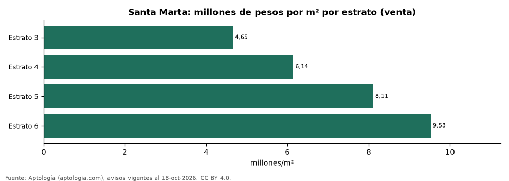

# Vivienda en Santa Marta: precio por m², arriendo, habitaciones, estrato y administración (octubre 2026)

**El barrio con el metro cuadrado más caro de Santa Marta es Pozos Colorado, con 12,35 millones de pesos en la mediana de apartamentos en venta; el más barato de la muestra es Jardín, con 4,31 millones de pesos.** Un apartamento de 2 habitaciones se arrienda por 3,50 millones de pesos al mes en la mediana y se vende por 700 millones de pesos. La rentabilidad bruta implícita del arriendo es 6,2 % anual. La administración equivale al 17,0 % del canon (553.000 pesos al mes en la mediana).

*Resumen: analizamos 4.606 avisos de apartamentos en Santa Marta (3.920 en venta y 686 en arriendo).*

**Actualizado:** 18 de octubre de 2026 (datos del 18 de octubre de 2026) · **Próxima actualización:** mensual.

## Resumen

| Indicador | Valor |
|---|---|
| Más caro (venta por m²) | Pozos Colorado: 12,35 millones de pesos |
| Más barato (venta por m²) | Jardín: 4,31 millones de pesos |
| Venta por m² (mediana) | 8,72 millones de pesos |
| Arriendo 2 habitaciones | 3,50 millones de pesos |
| Rentabilidad bruta implícita | 6,2 % |
| Administración / canon (mediana) | 17,0 % |
| Avisos | 4.606 |

## Barrios (30 avisos o más)

| Barrio | Venta por m² (millones de pesos) | Arriendo mensual (millones de pesos) | Avisos (venta / arriendo) |
|---|---|---|---|
| Pozos Colorado | 12,35 | — | 39 / — |
| Bello Horizonte | 10,67 | 4,50 | 439 / 73 |
| Vista Hermosa | 10,50 | — | 36 / — |
| Pozos Colorados | 10,50 | 3,00 | 498 / 89 |
| Santa Marta | 10,06 | — | 30 / — |
| Playa Salguero | 9,84 | 3,50 | 293 / 39 |
| Ub Salguero | 9,69 | — | 101 / — |
| Urbanizacion Salguero | 9,62 | 3,48 | 157 / 34 |
| Don Jaca | 9,33 | — | 87 / — |
| Rodadero Sur | 7,59 | 3,50 | 252 / 49 |
| Bellavista | 7,55 | — | 106 / — |
| Centro | 6,36 | — | 54 / — |
| Rodadero Reservado | 6,04 | — | 53 / — |
| El Rodadero | 6,03 | — | 55 / — |
| Rodadero | 5,95 | 2,40 | 405 / 49 |
| El Prado | 5,46 | — | 36 / — |
| Bavaria | 4,43 | — | 141 / — |
| Jardín | 4,31 | — | 30 / — |

Medianas de apartamentos; — indica menos de 30 avisos. El canon es mensual, sin administración ni gastos comunes.

## Precio por número de habitaciones

| Habitaciones | Precio de venta (mediana) | Arriendo mensual (mediana) | Avisos (venta / arriendo) |
|---|---|---|---|
| 1 | 450 millones de pesos | 2,60 millones de pesos | 1.088 / 219 |
| 2 | 700 millones de pesos | 3,50 millones de pesos | 1.409 / 268 |
| 3 o más | 760 millones de pesos | 4,17 millones de pesos | 1.410 / 192 |

## Por estrato

| Estrato | Venta por m² (millones) | Arriendo mensual (millones) | Avisos (venta / arriendo) |
|---|---|---|---|
| 3 | 4,65 | 1,70 | 216 / 66 |
| 4 | 6,14 | 2,42 | 489 / 132 |
| 5 | 8,11 | 2,80 | 710 / 113 |
| 6 | 9,53 | 3,95 | 2.243 / 365 |

Medianas; — indica menos de 30 avisos.

## Preguntas frecuentes

**¿Cuál es el barrio más caro de Santa Marta?**
Pozos Colorado, con 12,35 millones de pesos por m² en apartamentos en venta (octubre de 2026).

**¿Dónde es más barato comprar apartamento en Santa Marta?**
Entre los barrios con 30 avisos o más, en Jardín: 4,31 millones de pesos por m².

**¿Cuánto renta un apartamento en Santa Marta?**
La rentabilidad bruta implícita es 6,2 % anual (arriendo por m² × 12 ÷ precio de venta por m²), antes de gastos.

**¿Cuánto cuesta arrendar un apartamento de 2 habitaciones en Santa Marta?**
3,50 millones de pesos al mes en la mediana (octubre de 2026).

## Metodología

- **Fuente:** exportes nocturnos de la base de datos de Aptología (aptologia.com) del 18 de octubre de 2026: avisos vigentes de vivienda en portales inmobiliarios de 13 países, recogidos por Aptología y vistos en línea entre el 11 y el 18 de octubre de 2026. Corte: 18 de octubre de 2026.
- **Depuración:** se eliminan duplicados exactos (misma ciudad, zona, tipo, precio, moneda, área, habitaciones y baños) y los precios fuera del percentil 1–99 de cada país, operación, moneda y tipo; el precio por m² usa solo avisos con área declarada entre 12 y 2.000 m² y también se recorta al P1–P99.
- **Qué se mide:** precios pedidos (publicados), no precios de cierre. En arriendo, el canon mensual sin administración, gastos comunes ni condominio.
- **Muestra mínima:** cada cifra publicada se apoya en al menos 30 avisos; las celdas con menos se omiten.
- **Colombia:** Precios en pesos colombianos, sin conversión de moneda. Administración ÷ canon con razones entre 1 % y 80 %.
- **Limitaciones:** la cobertura depende de los portales que recorre Aptología en cada país y es mayor en las ciudades grandes y en los segmentos medio-alto y alto; el área es la que declara el aviso, sin verificar; los nombres de zona vienen de los portales.
- **Privacidad:** solo se publican agregados; no se publica ningún dato personal, enlace a avisos ni nombre de anunciante.
- **Datos abiertos:** [datos.csv](datos.csv), licencia CC BY 4.0.

## Cómo citar

Pinzón Pineda, D. M. (2026). *Vivienda en Santa Marta: precio por m², arriendo, habitaciones, estrato y administración (octubre 2026)*. Aptología (aptologia.com). https://github.com/elbroker/aptologia-datos/tree/main/estudios/vivienda-santa-marta-venta-arriendo-rentabilidad-2026. Datos: datos.csv, licencia CC BY 4.0.
