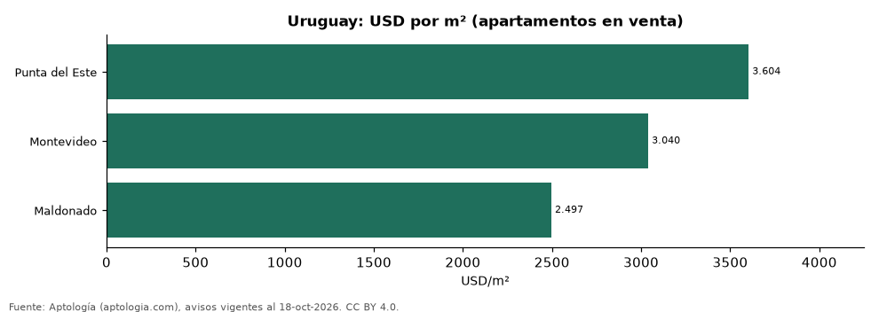

# Vivienda en Uruguay por ciudad: precio por m², arriendo de 2 habitaciones y años de arriendo en 3 ciudades (octubre 2026)

**El metro cuadrado de apartamento más caro de Uruguay está en Punta del Este, con USD 3.604 en la mediana de avisos en venta; el más barato de las 3 ciudades medidas, en Maldonado, con USD 2.497.** En Montevideo, un apartamento de 2 habitaciones se arrienda por USD 826 al mes y se vende por USD 203.500: 20,5 años de arriendo.

*Resumen: analizamos 15.647 avisos de apartamentos en 3 ciudades de Uruguay.*

**Actualizado:** 18 de octubre de 2026 (datos del 18 de octubre de 2026) · **Próxima actualización:** mensual.

## Resumen

| Indicador | Valor |
|---|---|
| Más caro (m²) | Punta del Este: USD 3.604 |
| Más barato (m²) | Maldonado: USD 2.497 |
| Montevideo: arriendo 2 hab. | USD 826 |
| Avisos | 15.647 |

## Ciudades de Uruguay

| Ciudad | Venta USD/m² | Apto. 2 hab. en venta | Arriendo 2 hab. al mes | Años de arriendo | Moneda (venta / arriendo) | Avisos (venta / arriendo) |
|---|---|---|---|---|---|---|
| Punta del Este | USD 3.604 | USD 310.000 | USD 3.800 | — | USD / USD | 5.198 / 2.464 |
| Montevideo | USD 3.040 | USD 203.500 | USD 826 | 20,5 | USD / UYU | 4.642 / 3.140 |
| Maldonado | USD 2.497 | USD 150.000 | — | — | USD / UYU | 179 / 24 |

Medianas de apartamentos; — indica menos de 30 avisos. Años de arriendo = precio de 2 habitaciones ÷ (arriendo de 2 habitaciones × 12); no se calcula en destinos de temporada.

## Preguntas frecuentes

**¿Cuál es la ciudad más cara de Uruguay para comprar?**
Punta del Este: USD 3.604 por m² en la mediana (octubre de 2026).

**¿Cuánto cuesta arrendar en Montevideo?**
Un apartamento de 2 habitaciones, USD 826 al mes en la mediana.

## Metodología

- **Fuente:** exportes nocturnos de la base de datos de Aptología (aptologia.com) del 18 de octubre de 2026: avisos vigentes de vivienda en portales inmobiliarios de 13 países, recogidos por Aptología y vistos en línea entre el 11 y el 18 de octubre de 2026. Corte: 18 de octubre de 2026.
- **Depuración:** se eliminan duplicados exactos (misma ciudad, zona, tipo, precio, moneda, área, habitaciones y baños) y los precios fuera del percentil 1–99 de cada país, operación, moneda y tipo; el precio por m² usa solo avisos con área declarada entre 12 y 2.000 m² y también se recorta al P1–P99.
- **Qué se mide:** precios pedidos (publicados), no precios de cierre. En arriendo, el canon mensual sin administración, gastos comunes ni condominio.
- **Muestra mínima:** cada cifra publicada se apoya en al menos 30 avisos; las celdas con menos se omiten.
- **Monedas:** nunca se mezclan avisos de monedas distintas sin convertirlos. Conversión a dólares con la tasa de mercado de ExchangeRate-API (open.er-api.com, actualización del 18 Oct 2026): 1 USD = 3.182,80 COP, 1 USD = 18,47 M.N, 1 USD = 5,09 BRL, 1 USD = 3,44 PEN, 1 USD = 982,44 CLP, 1 USD = 1.514,57 ARS, 1 USD = 40,20 UYU, 1 USD = 5.705,37 PYG, 1 USD = 61,27 DOP, 1 USD = 0,89 EUR, 1 USD = 11,72 BOB; la UF chilena a 41.178,64 CLP (mindicador,cl. 18-oct-2026). Los avisos publicados en dólares se usan tal cual.
- **Monedas:** en cada ciudad y operación se usa solo la moneda mayoritaria de los avisos (los avisos en otra moneda se excluyen) y la mediana se convierte a dólares con la tasa citada; nunca se promedian avisos de monedas distintas.
- **Destinos de temporada:** Punta del Este, Maldonado y Punta Cana se excluyen de las comparaciones de años de arriendo porque muchos avisos de alquiler son de temporada (precio mensual de verano), lo que infla el canon y daría una relación artificialmente baja.
- **Limitaciones:** la cobertura depende de los portales que recorre Aptología en cada país y es mayor en las ciudades grandes y en los segmentos medio-alto y alto; el área es la que declara el aviso, sin verificar; los nombres de zona vienen de los portales.
- **Privacidad:** solo se publican agregados; no se publica ningún dato personal, enlace a avisos ni nombre de anunciante.
- **Datos abiertos:** [datos.csv](datos.csv), licencia CC BY 4.0.

## Cómo citar

Pinzón Pineda, D. M. (2026). *Vivienda en Uruguay por ciudad: precio por m², arriendo de 2 habitaciones y años de arriendo en 3 ciudades (octubre 2026)*. Aptología (aptologia.com). https://github.com/elbroker/aptologia-datos/tree/main/estudios/vivienda-uruguay-por-ciudad-2026. Datos: datos.csv, licencia CC BY 4.0.
