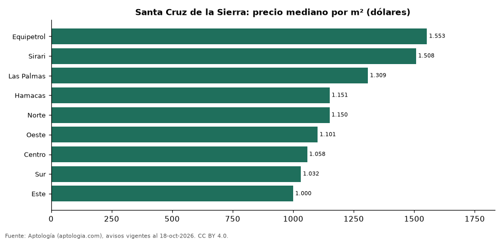

# Zonas más caras y más baratas de Santa Cruz de la Sierra para comprar departamento: ranking por m² (octubre 2026)

**En Santa Cruz de la Sierra, la zona con el m² más caro para comprar departamento es Equipetrol (USD 1.553/m²) y la más barata Este (USD 1.000/m²), 1,6 veces menos.** Comparamos 9 zonas con al menos 30 avisos con área.

*Resumen: analizamos 1.550 departamentos en venta con área declarada en 9 zonas de Santa Cruz de la Sierra.*

**Actualizado:** 18 de octubre de 2026 (datos del 18 de octubre de 2026) · **Próxima actualización:** mensual.

## Resumen

| Indicador | Valor |
|---|---|
| Más caro por m² | Equipetrol: USD 1.553 |
| Más barato por m² | Este: USD 1.000 |
| Diferencia | 1,6 veces |
| Zonas | 9 |

## Ranking de zonas por precio del m²

| Zona | Por m² (mediana) | Precio (mediana) | Área mediana (m²) | Avisos con área |
|---|---|---|---|---|
| Equipetrol | USD 1.553 | USD 120.000 | 80 | 446 |
| Sirari | USD 1.508 | USD 72.000 | 44 | 46 |
| Las Palmas | USD 1.309 | USD 175.714 | 146 | 40 |
| Hamacas | USD 1.151 | USD 105.000 | 92 | 69 |
| Norte | USD 1.150 | USD 95.000 | 85 | 499 |
| Oeste | USD 1.101 | USD 103.458 | 93 | 189 |
| Centro | USD 1.058 | USD 95.000 | 95 | 109 |
| Sur | USD 1.032 | USD 95.000 | 100 | 104 |
| Este | USD 1.000 | USD 95.000 | 96 | 48 |

Medianas; solo zonas con 30 avisos o más con área declarada.

## Preguntas frecuentes

**¿Cuál es la zona más cara de Santa Cruz de la Sierra para comprar?**
Equipetrol, con USD 1.553 por m² en la mediana (octubre de 2026).

**¿Y la más barata?**
Este, con USD 1.000 por m².

## Metodología

- **Fuente:** exportes nocturnos de la base de datos de Aptología (aptologia.com) del 18 de octubre de 2026: avisos vigentes de vivienda en portales inmobiliarios de 13 países, recogidos por Aptología y vistos en línea entre el 11 y el 18 de octubre de 2026. Corte: 18 de octubre de 2026.
- **Depuración:** se eliminan duplicados exactos (misma ciudad, zona, tipo, precio, moneda, área, habitaciones y baños) y los precios fuera del percentil 1–99 de cada país, operación, moneda y tipo; el precio por m² usa solo avisos con área declarada entre 12 y 2.000 m² y también se recorta al P1–P99.
- **Qué se mide:** precios pedidos (publicados), no precios de cierre. En arriendo, el canon mensual sin administración, gastos comunes ni condominio.
- **Muestra mínima:** cada cifra publicada se apoya en al menos 30 avisos; las celdas con menos se omiten.
- **Monedas:** nunca se mezclan avisos de monedas distintas sin convertirlos. Conversión a dólares con la tasa de mercado de ExchangeRate-API (open.er-api.com, actualización del 18 Oct 2026): 1 USD = 3.182,80 COP, 1 USD = 18,47 M.N, 1 USD = 5,09 BRL, 1 USD = 3,44 PEN, 1 USD = 982,44 CLP, 1 USD = 1.514,57 ARS, 1 USD = 40,20 UYU, 1 USD = 5.705,37 PYG, 1 USD = 61,27 DOP, 1 USD = 0,89 EUR, 1 USD = 11,72 BOB; la UF chilena a 41.178,64 CLP (mindicador,cl. 18-oct-2026). Los avisos publicados en dólares se usan tal cual.
- **Monedas:** en cada ciudad y operación se usa solo la moneda mayoritaria de los avisos (los avisos en otra moneda se excluyen) y la mediana se convierte a dólares con la tasa citada; nunca se promedian avisos de monedas distintas.
- **Limitaciones:** la cobertura depende de los portales que recorre Aptología en cada país y es mayor en las ciudades grandes y en los segmentos medio-alto y alto; el área es la que declara el aviso, sin verificar; los nombres de zona vienen de los portales.
- **Privacidad:** solo se publican agregados; no se publica ningún dato personal, enlace a avisos ni nombre de anunciante.
- **Datos abiertos:** [datos.csv](datos.csv), licencia CC BY 4.0.

## Cómo citar

Pinzón Pineda, D. M. (2026). *Zonas más caras y más baratas de Santa Cruz de la Sierra para comprar departamento: ranking por m² (octubre 2026)*. Aptología (aptologia.com). https://github.com/elbroker/aptologia-datos/tree/main/estudios/zonas-mas-caras-y-baratas-santa-cruz-de-la-sierra-venta-m2-2026. Datos: datos.csv, licencia CC BY 4.0.
